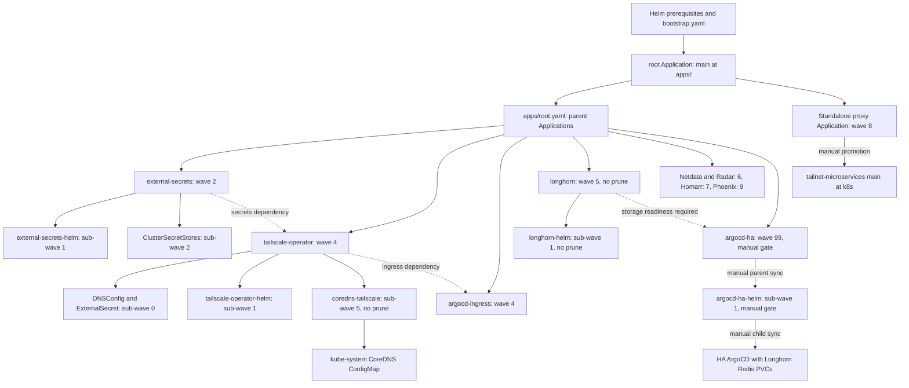

# ArgoCD reconciliation and promotion boundaries

Git is desired state, but **a Git update is not always permission to deploy**. Most Applications reconcile automatically; the two ArgoCD HA stages and the external Anthropic OAuth Proxy deliberately require manual sync. [The repository architecture document](../../docs/architecture.md) is the authoritative sync-policy reference.

## Entry point and ownership graph

Bootstrap first installs Cilium, External Secrets Operator (ESO), Longhorn, and non-HA ArgoCD with Helm. Those prerequisites break scheduling, CRD, and chart-hook bootstrap cycles; wave annotations are not a substitute for installing them. Applying [bootstrap/bootstrap.yaml](../../bootstrap/bootstrap.yaml) creates the `argocd` Namespace and the `root` Application, which tracks this repository's `main` at `apps/`, in project `default`, against the local Kubernetes API.

The root discovers the parent Application manifests in [apps/root.yaml](../../apps/root.yaml) **and** the standalone [apps/anthropic-oauth-proxy.yaml](../../apps/anthropic-oauth-proxy.yaml). Do not confuse the file named `root.yaml` with the `root` Application: the Application itself is declared in bootstrap. Directory-backed parents then reconcile their own local manifests and nested chart Applications. The proxy is different: it renders `k8s` from `basher83/tailnet-microservices` `main`, rather than a directory in this repository. This is an ownership graph, not one recursive Helm release.


*Root discovery, nested reconciliation scopes, local wave ordering, and the three intentional manual sync gates. Dotted edges express dependencies, not verified readiness.*

## Ordering is scoped, readiness must be checked

The documented outer sequence is:

| Wave | Reconciliation scope and intent |
|---|---|
| 2 | External Secrets stack: chart/controller/CRDs at sub-wave 1, then Infisical ClusterSecretStores at sub-wave 2 |
| 4 | Tailscale Operator and ArgoCD Ingress; within the operator parent, DNSConfig is at default wave 0, chart Application at 1, CoreDNS Application at 5 |
| 5 | Longhorn storage and its ingress; the nested chart Application is at sub-wave 1 |
| 6 | Netdata and Radar |
| 7 | Homarr |
| 8 | External Anthropic OAuth Proxy, manual sync |
| 9 | Phoenix |
| 99 | ArgoCD HA parent, manual sync |

ExternalSecrets use wave `0` within their parents so that secret definitions precede consuming chart Applications. The numbers order resources in the **Application that applies them**: the root applies parent Application objects; each parent applies local resources and nested Application objects; chart children reconcile chart output separately. A child sub-wave `1` is not a cluster-wide wave before root wave `2`.

Do not read these annotations as proof that a controller is ready, an ExternalSecret has populated a Secret, a nameserver is available, or a PVC can bind. ArgoCD Ingress and the Tailscale parent even share outer wave `4`. The committed HA chart configuration contains diff customizations, not an Application-health dependency evaluator. Bootstrap prerequisites and live readiness checks remain necessary, especially before promoting HA. See [bootstrap and triage](../operations/bootstrap-and-triage.md) and [secrets](../integrations/secrets.md).

## Automatic convergence and intentional promotion gates

The normal policy is automated sync with `prune: true`, `selfHeal: true`, and `ServerSideApply=true`. Many directory parents also retry five times with exponential backoff starting at `5s`, factor `2`, capped at `3m`. This is bounded retry, not a dependency-readiness guarantee. The bootstrap root itself specifies automated prune and self-heal but does not explicitly set SSA.

Preserve these exceptions when adding or refactoring Applications:

| Application | Policy boundary |
|---|---|
| `longhorn` | Automated, self-healing, **no automated prune** of its local resources and nested Application definitions |
| `longhorn-helm` | Automated, self-healing, **no automated prune** of chart-owned resources, especially CRDs |
| `coredns-tailscale` | Automated, self-healing, **no automated prune**; retains CoreDNS config while restoring forwarding after Talos overwrites |
| `argocd-ha` | No automated sync; manually promote the directory contents |
| `argocd-ha-helm` | No automated sync; separately promote the actual ArgoCD chart |
| `anthropic-oauth-proxy` | No automated sync; explicitly promote external-repository `main` |

For ordinary auto-synced charts, merging the exact-pinned chart revision or values change is the promotion step. Chart versions are exact-pinned and Renovate proposes updates. ArgoCD chart changes are not auto-merged: merging changes Git, while both manual HA stages still control cluster promotion.

After verifying Longhorn is healthy and can provision PVCs, promote HA in two steps:

```bash
argocd app sync argocd-ha
argocd app sync argocd-ha-helm
```

Syncing only the parent updates the nested Application specification; it does not authorize the nested manual chart sync. The chart enables Redis HA with persistent Longhorn storage. The gate also covers ArgoCD account/RBAC changes such as Radar's read-only `applications get` account, not just replica topology. See [Radar](../integrations/radar.md).

The proxy gate is a separate cross-repository contract: the architecture document records that upstream CI does not gate manifest validity, including bot tag bumps carrying `[skip ci]`. This repository intentionally tracks `main` rather than an exact SHA, so inspect the external revision and manifest changes before manually syncing `anthropic-oauth-proxy`. A moving source branch is not evidence of a validated release. See [application changes](../workflows/application-changes.md).

## Drift ownership: ignore only the fields another controller owns

Self-heal restores Git-owned desired state; it should not fight legitimate controller defaults or refreshed credentials. The manifests establish narrow exceptions:

- Directory parents such as Tailscale, Longhorn, and Radar ignore ESO-added `remoteRef.conversionStrategy`, `decodingStrategy`, and `metadataPolicy` across **all** `.spec.data[]` entries, with `RespectIgnoreDifferences=true`. The parent owns the ExternalSecret definition; ESO owns its defaults and materializes the Secret.
- The nested Tailscale chart references ESO's `operator-oauth` Secret and ignores that Secret's `/data`, annotations, and labels, again respecting the ignores during sync.
- Selected parents ignore Service `/spec/externalName`. The HA chart configures global ignores for `/status/terminatingReplicas` on Deployments, StatefulSets, ReplicaSets, and DaemonSets. Because that config is inside the HA chart, it inherits the manual gates.

[CoreDNS reconciliation](../../apps/tailscale-operator/coredns-patch.yaml) is a deliberate counterexample to ignoring external writes: SSA plus self-heal restores the committed `ts.net` forwarding after Talos lifecycle events overwrite the ConfigMap. The committed target is `10.108.67.5`; if DNSConfig is recreated, verify the nameserver Service ClusterIP before trusting the restored forwarding:

```bash
kubectl get svc nameserver -n tailscale-operator -o jsonpath='{.spec.clusterIP}'
```

For repeated drift, inspect the diff at the owning Application level before adding ignores. SSA also does not guarantee removal of obsolete fields: the troubleshooting guide documents `RollingUpdate` to `Recreate` transitions failing unless stale `rollingUpdate` fields are cleared. Prefer correct desired values over broad ignores or unreviewed resource replacement.

## Deletion safety has four separate layers

**No single prune flag is universal deletion protection.** Review the whole ownership path before removing manifests or Applications.

1. **Parent pruning:** `root` has automated prune enabled. Removing a parent Application definition from its source is therefore different from removing a resource inside a no-prune parent. `longhorn` disabling its own prune does not disable root's policy.
2. **Nested chart pruning:** `longhorn-helm` separately disables prune. The parent's setting cannot protect chart output if the child has prune enabled. A chart revision that stops rendering a CRD can otherwise make it prune-eligible; deleting that CRD also removes its stored custom resources and can destroy the storage control plane.
3. **Application deletion/finalizers:** bootstrap `root`, the directory parents in `apps/root.yaml`, and the standalone proxy carry `resources-finalizer.argocd.argoproj.io`. Cascading Application deletion is a different path from automated pruning. The inspected nested Longhorn, CoreDNS, and HA chart Application manifests do not declare that finalizer; do not infer blanket cascade behavior or immunity from the parent policy alone. In particular, the CoreDNS no-prune comment expresses a preservation intent, not permission to delete its ancestors casually.
4. **PVC/PV reclamation:** the custom `longhorn-critical`, `longhorn-important`, and `longhorn-standard` StorageClasses all use `reclaimPolicy: Delete`. Deleting a consuming PVC can therefore reclaim its backing storage regardless of Longhorn Application prune settings. Protecting controllers and CRDs is not protecting workload data.

Before destructive changes, inspect live Application finalizers and resource ownership, review the proposed prune set, and check the affected PVC/PV reclaim policy and backups. Use [storage and backups](../operations/storage-and-backups.md) for data protection rather than treating Git reconstruction as data recovery.

## What validation proves—and does not

The repository's `Fast Gate` runs `mise run ci`, including [validate-gitops.sh](../../scripts/validate-gitops.sh). The script finds chart Applications, rejects floating revisions, renders exact versions with committed values and CRDs, and validates rendered resources with kubeconform. It rejects unsupported Helm `valueFiles` and `parameters`; missing schemas are ignored.

That is useful static promotion evidence, **not** a live reconciliation or dependency test: it does not prove CRD semantics, admission behavior, nameserver IP correctness, secret refresh, storage provisioning, or runtime health. After a change, check the owning parent and child Applications separately, then the relevant controllers and workloads. `Synced`, `Healthy`, and the last operation result are separate signals: the documented Longhorn recovery case can leave a historical failed operation even after desired and live state converge. Do not force a downgrade or enable prune merely to clear an old failure badge.

Further source guidance: [architecture](../../docs/architecture.md), [bootstrap procedure](../../README.md#bootstrap), and [reconciliation troubleshooting](../../docs/troubleshooting.md).
