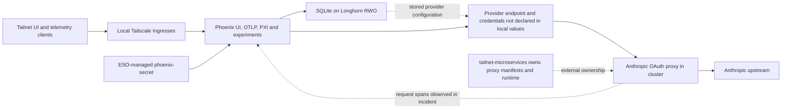

# Dashboard, telemetry, and LLM workload contracts

These workloads depend on more than their Helm revisions: persistent application state, ESO-owned keys, Tailscale routing, and cross-repository promotion all affect safe changes. Homarr, Netdata, and Phoenix have automated prune/self-heal; the proxy has a deliberate manual sync gate. See [application changes](../workflows/application-changes.md) for the broader promotion workflow.

## Homarr: preserve the database and its encryption identity

Homarr stores its database on a **1 GiB Longhorn ReadWriteOnce volume**, configured under `persistence.homarrDatabase`—not `persistence.database`. Its `strategyType: Recreate` avoids overlapping old and new pods competing for RWO volume placement during upgrades. Treat rollout interruption as intentional rather than replacing this with a rolling strategy to chase availability.

The `homarr-db-encryption` ExternalSecret reads `HOMARR_DB_KEY` through `infisical-homarr` and creates `db-encryption` with key `db-encryption-key`. It refreshes hourly at sync wave 0, before the nested Helm Application at wave 1. The Helm Application ignores that Secret's data, annotations, and labels and enables `RespectIgnoreDifferences=true`, preserving ESO's ownership instead of fighting it during reconciliation. Preserve the database and its encryption key as a coupled recovery concern; the database PVC alone does not describe its encryption identity.

Proxmox integration also has an explicit network dependency. Three Services in namespace `homarr`—`proxmox-foxtrot`, `proxmox-alpha`, and `proxmox-lloyd`—declare Tailscale egress targets `foxtrot.tailfb3ea.ts.net`, `alpha.tailfb3ea.ts.net`, and `lloyd.tailfb3ea.ts.net`. Each is an `ExternalName` Service with `externalName: placeholder` and a `tailscale.com/tailnet-fqdn` annotation: this is an operator-mediated egress contract, not a literal upstream hostname to copy into a replacement DNS configuration. The manifests establish reachability targets, not Proxmox API credentials or Homarr's saved integration settings.

Sources: [Homarr values](../../apps/homarr/application.yaml), [encryption Secret](../../apps/homarr/externalsecret.yaml), [Proxmox egress](../../apps/homarr/proxmox-egress.yaml). See [Tailscale networking](../integrations/tailscale-networking.md) and [secrets](../integrations/secrets.md).

## Netdata: claiming and collection are separate contracts

Both `parent` and `child` enable claiming, leave chart `token` and `rooms` values empty, and load `netdata-claiming` through `envFrom`. The actual ExternalSecret mapping is authoritative:

| Infisical key through `infisical-netdata` | Kubernetes environment key |
|---|---|
| `CLAIMING_TOKEN` | `NETDATA_CLAIM_TOKEN` |
| `CLAIMING_ROOM` | `NETDATA_CLAIM_ROOMS` |

Do not infer remote key names from the older shorthand in the file comment. The Secret refreshes hourly and precedes the Helm Application by sync wave. Claiming changes must preserve both the parent and child injection paths.

The `k8sState` Go collector configuration sets `default_run: no` and explicitly enables `k8s_state` and `coredns`. The CoreDNS job scrapes `http://kube-dns.kube-system.svc.cluster.local:9153/metrics`. A collector change therefore needs validation against that cluster Service endpoint, not only a healthy Netdata UI. The chart is pinned, but its configured image tag is `stable`; chart pinning does not itself constitute an immutable image pin.

**Netdata telemetry is not automatically Radar telemetry.** Radar's scheduling capacity uses allocatable resources and requests; live usage needs the Kubernetes Metrics API and permissions, and PromQL needs a separate Prometheus-compatible endpoint. The 2026-08-16 troubleshooting observation found no Metrics APIService or connected Prometheus service, with Radar `rbac.metrics: false`. That is a dated diagnosis, not proof of today's live state. Missing samples are unknown, not zero. See [Radar](../integrations/radar.md).

Sources: [Netdata values](../../apps/netdata/application.yaml), [claiming mapping](../../apps/netdata/externalsecret.yaml), [telemetry troubleshooting](../../docs/troubleshooting.md#radar-shows-no-cpu-or-memory-samples-while-netdata-is-healthy).

## Phoenix: SQLite state and stable provider encryption

Phoenix disables PostgreSQL and uses SQLite with a **10 GiB Longhorn RWO volume**. It uses `deployment.strategy.type: Recreate` and explicitly sets `rollingUpdate: null`. Both matter: under ServerSideApply, setting only `type` can leave stale `rollingUpdate` subfields behind, causing Kubernetes to reject the Deployment. Inspect the rendered strategy on upgrades rather than assuming chart value names are interchangeable with Homarr's.

Phoenix is a ClusterIP backend with built-in ingress disabled. Local Tailscale Ingresses route `phoenix` to `phoenix-helm-svc:6006` for UI and HTTP OTLP, and `phoenix-otlp` to port `4317` for gRPC OTLP. `auth.enableAuth: false` is explicit because chart versions starting at 9.x default authentication on. The declared rationale is Tailscale-only access and frictionless OTLP ingestion; this is not evidence of a NetworkPolicy preventing direct cluster access.

### Secret injection is part of chart compatibility

`phoenix-secret` is ESO-owned, refreshed hourly through `infisical-phoenix`, with `PHOENIX_SECRET` and `PHOENIX_ADMIN_SECRET`. The chart must keep:

- `auth.createSecret: false`, so a fresh chart render does not generate a different encryption key.
- `auth.secret` restricted to those two keys. Chart defaults also request `PHOENIX_POSTGRES_PASSWORD`, `PHOENIX_SMTP_PASSWORD`, and `PHOENIX_DEFAULT_ADMIN_INITIAL_PASSWORD`. Those unused keys are absent here; retaining their default references causes `CreateContainerConfigError`.

`PHOENIX_SECRET` protects stored provider configuration even with authentication disabled. The source records that chart-generated key rotation during the 5.x → 9.x upgrade made the stored PXI provider configuration undecryptable. Do not treat this key as disposable merely because users do not log in.

PXI remains enabled and uses Phoenix's **stored provider configuration**, described in the Application comments as pointing at the in-cluster Anthropic OAuth proxy. The provider endpoint and credentials are not declared as local Helm values. `allowExternalResources` remains at the chart default, `true`, including PXI web search. Comments record healthy pod egress on 2026-06-12 after a Cilium MTU issue; do not recycle the earlier missing-egress hypothesis as a current diagnosis.


*Phoenix's local storage and Secret contract connects to a stored provider configuration and an externally owned proxy; the diagram does not imply that planned proxy isolation is deployed.*

Sources: [Phoenix values](../../apps/phoenix/application.yaml), [Secret rationale](../../apps/phoenix/externalsecret.yaml), [Ingresses](../../apps/phoenix/ingress.yaml), [streaming incident](../../docs/incidents/2026-08-27-phoenix-experiment-timeouts.md).

### Migration rollback is a data operation

Before an upgrade that migrates the on-disk schema, take a Longhorn snapshot and verify `status.readyToUse`. Reverting a chart revision **does not reverse the SQLite migration**: rollback requires reverting the bump **and restoring the volume**. The storage runbook specifically identifies `phoenix/phoenix-helm-data-pvc` as having no backup tier; the plain `longhorn` StorageClass provides no automatic backup assignment. Do not infer backup coverage from persistence being enabled.

The runbook accepts a running-pod snapshot as crash-consistent for SQLite. Snapshot objects are not ArgoCD-managed; record them and clean them up after the upgraded version has proved stable. Follow [storage and backups](../operations/storage-and-backups.md) and the [pre-upgrade snapshot procedure](../../docs/backup-storage.md#pre-upgrade-snapshots).

## Proxy ownership and authorization: planned remediation, not deployed controls

The local `anthropic-oauth-proxy` Application tracks `https://github.com/basher83/tailnet-microservices.git`, branch `main`, path `k8s`, and deploys into namespace `anthropic-oauth-proxy`. It has **no automated sync**. Manual promotion is intentional because source-repository CI does not gate manifest validity. This repository owns the ArgoCD gate and cluster validation, not duplicate copies of the proxy's Kubernetes resources or Rust handlers.

Keep three evidence classes separate:

| Evidence class | What the boundary specification establishes |
|---|---|
| Source findings | At the assessed source revisions, main and admin HTTP surfaces lacked application credentials and were exposed through Services. Admin operations included OAuth completion and account deletion. This is not a fresh cluster inspection. |
| Live observations recorded in the 2026-07-30 specification | The assessment found a wildcard tailnet grant, shared proxy device tag `tag:k8s`, operator tag `tag:k8s-operator`, and ordinary-pod routing to both ClusterIPs. These observations must be rechecked before rollout. |
| Proposed controls—**not implemented by the specification** | Remove the admin Service, bind admin to pod loopback if port-forward tests succeed, and restrict main port 8080 by NetworkPolicy to the actual Tailscale ingress proxy and proven-required probes. |

The selected authorization model allows broad tailnet membership on the main proxy and kubeconfig/RBAC-authorized port-forward on admin. Ordinary Kubernetes pods are not authorized callers of either. A tailnet tag is not a Kubernetes NetworkPolicy selector; implementation must discover the actual ingress proxy namespace and stable pod labels.

This creates a review-critical coupling: Phoenix currently describes an **in-cluster** provider route, while the planned policy denies ordinary workloads that direct route. Reconcile the stored Phoenix endpoint with the chosen authorization path before promotion; neither this page nor the specification grants Phoenix a new bypass exception.

Required rollout checks include a successful tailnet request, an ordinary-pod connection denied to main, no rendered admin Service or Tailscale admin exposure, ordinary-pod admin denial, working RBAC-authorized port-forward, and healthy probes. Source render assertions must pass before manual promotion. A green ArgoCD sync does not close the security findings. If ingress selectors fail, roll back through source/Git and ArgoCD; do not recreate an admin Service as a workaround. A rollback reopens the affected finding.

Source: [boundary remediation specification](../../specs/oauth-proxy-boundary-remediation.md), [local promotion gate](../../apps/anthropic-oauth-proxy.yaml).

## Diagnose experiment timeouts at the stream boundary

The **2026-08-27 incident** diagnosed Phoenix **20.4.0**, not every future version. Its server-side experiment runner applied a 120-second wall-clock deadline around consumption of the complete model stream. After the initial attempt and three retries it persisted a terminal timeout without partial output or token usage. Manual Playground requests could complete beyond 120 seconds because they were not subject to that server-side experiment deadline.

Start by checking cadence:

```bash
kubectl -n phoenix logs deploy/phoenix-helm --since=24h \
  | rg 'TaskWorkItem .* timed out|circuit breaker'
```

Correlate three surfaces: experiment results, Playground `ChatCompletion` spans, and `proxy_request` spans in Phoenix's `anthropic-oauth-proxy` project. The deployed proxy's `request completed` logs and spans ended at **upstream response headers**, not stream completion. Status 200 or `OK` proves acceptable headers, not a completed body. Missing experiment output and usage are censored observations—not zero tokens, zero elapsed work, or proof of an authentication failure.

Approximately 120-second waves support the caller-deadline hypothesis. Immediate 401/403/429, refresh failures, account cooldown, upstream 5xx, or failed tailnet health instead need separate investigation. The incident rejected proxy/network/authentication failure and local resource saturation for that window, not for all later failures. Longer output was demonstrated for one characterized dataset example, not all unobserved failed streams.

Potential mitigations remain reviewed choices: verify an SDK/client-side experiment path, shorten the deliverable and measure repeated runs, or verify a supported configurable timeout in the exact release. Do not use a low `max_tokens` ceiling as a substitute for concision: it can truncate required final sections. See [the runbook](../../docs/troubleshooting.md#phoenix-experiments-time-out-while-manual-playground-runs-succeed) and [full incident evidence](../../docs/incidents/2026-08-27-phoenix-experiment-timeouts.md).

## Focused change validation

Run `mise run ci` for repository checks. The [render validator](../../scripts/validate-gitops.sh) renders exact-pinned Helm Applications with committed values and validates built-in resources using kubeconform; it skips Helm tests and missing schemas. It does not validate the external proxy's Kustomize source, live Secret availability, admission, network enforcement, or completed provider streams.

For these workloads, complement that static gate with targeted checks: verify Homarr's database mount and Proxmox reachability, both Netdata claiming paths and CoreDNS scraping, Phoenix's two-key Secret injection and effective Recreate strategy, and provider decryption plus a completed streamed request. Before a Phoenix schema migration, prove snapshot readiness; before proxy promotion, run the specification's positive and negative trust-zone tests. These are runtime acceptance checks, not outcomes guaranteed by a successful render.
