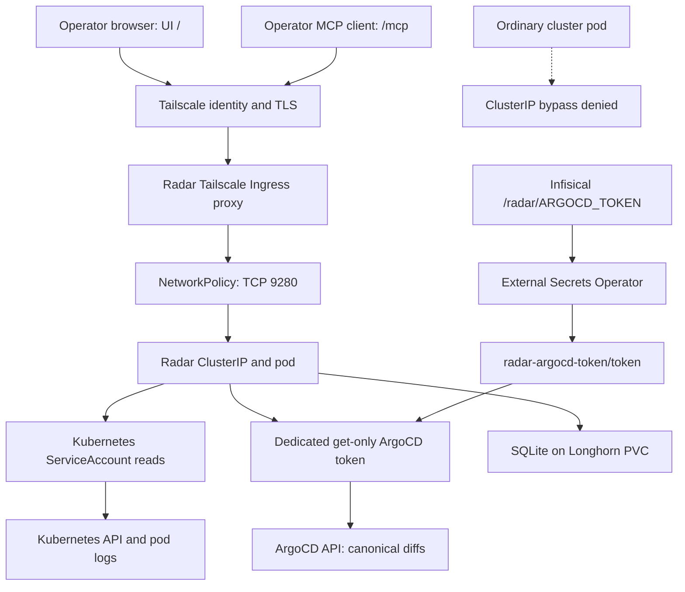

# Radar UI, MCP, and read-only ArgoCD diffs

Radar is the single-cluster, single-operator Kubernetes UI and MCP server for `talos-prod-01`. It complements `kubectl` and the existing Kubernetes MCP path with curated issues, topology, resource relationships, deduplicated events, filtered pod logs, and change history. Its canonical Git-rendered desired-versus-live diffs use the ArgoCD API, not just Kubernetes annotations.

**Two independent credentials define its authority:** the chart-managed Kubernetes ServiceAccount supplies cluster reads, while a dedicated get-only ArgoCD account supplies canonical diffs. Neither expands the other's permissions. MCP tool advertising and agent confirmation prompts are not authorization boundaries.

## Request flow and trust boundary


*UI and MCP share a tailnet entrypoint but use separate Kubernetes and ArgoCD credentials downstream.*

The expected endpoints are:

- UI: `https://radar.tailfb3ea.ts.net/`
- MCP: `https://radar.tailfb3ea.ts.net/mcp`

Radar deliberately uses `auth.mode: none`: Tailscale device/user authorization and TLS are the external access controls. There is no Radar OIDC, proxy auth, per-user Kubernetes impersonation, or new human RoleBinding. All UI and MCP callers share the process's authority. This is an explicit single-operator exception, not a multi-user authentication design; expanding the audience or changing the tailnet trust boundary requires a separate auth decision. Personal MCP client configuration remains workstation state, outside this repository.

The local [Ingress](../../apps/radar/ingress.yaml) uses class `tailscale`, hostname `radar`, and default backend Service `radar:9280`. Chart Ingress and HTTPRoute creation are disabled. The [NetworkPolicy](../../apps/radar/networkpolicy.yaml) prevents ordinary workloads from bypassing Tailscale via the ClusterIP:

- It selects pods with `app.kubernetes.io/name: radar` and `app.kubernetes.io/instance: radar`.
- Its only allowed peer combines namespace `tailscale-operator` **and** the four proxy labels: `tailscale.com/managed: "true"`, `tailscale.com/parent-resource: radar`, `tailscale.com/parent-resource-ns: radar`, and `tailscale.com/parent-resource-type: ingress`.
- Namespace and pod selectors belong to the **same** `from` item, so they are ANDed. Splitting them would widen access.
- Only TCP `9280` is admitted. Egress is not restricted by this policy.

The generated proxy `app` UUID is not a stable selector. Recheck operator labels after upgrades. A wrong proxy selector fails closed by making Radar unavailable; do not repair it with a namespace-wide or node-wide allow rule. See [Tailscale networking](tailscale-networking.md).

## Read-only means authorization, not hidden tools

The [Helm configuration](../../apps/radar/application.yaml) creates chart-managed read-only RBAC, including supported CRD reads such as ArgoCD resources. Pod-log reads stay enabled. Secrets, Helm mutation, RBAC-object and webhook visibility, pod exec, port-forward, self-upgrade, traffic, and metrics permissions are explicitly disabled; workload and node mutation are outside the approved authority. Radar Cloud is disabled too.

Radar may advertise write MCP tools, but the selected ServiceAccount cannot execute their writes. Enabling additional RBAC flags or adding write rules changes the authority of **every** MCP caller and requires explicit review. Logs can contain application data despite redaction, so tailnet access also confers access to every pod log the ServiceAccount can read.

### Dedicated ArgoCD authority

The [ArgoCD Helm values](../../apps/argocd/ha-upgrade.yaml) define only an API-key-capable local account and Application read policy:

```yaml
accounts.radar: apiKey
```

```text
p, role:radar, applications, get, */*, allow
g, radar, role:radar
```

This is not an admin or personal token and grants no `sync`, `update`, `delete`, `action`, or `override` authority. The pinned API endpoint is `http://argocd-ha-helm-server.argocd.svc.cluster.local`, matching the server's internal insecure HTTP mode. Radar sets `insecureTls: false`; a future HTTPS endpoint must retain TLS verification rather than enabling an insecure exception. Do not route the in-cluster integration through the Tailscale ingress.

The token flows from Infisical project `mothership-s0-ew`, environment `prod`, path `/radar/ARGOCD_TOKEN`, through [ClusterSecretStore `infisical-radar`](../../apps/external-secrets/clustersecretstore.yaml), into the [ExternalSecret](../../apps/radar/externalsecret.yaml). ESO refreshes hourly and owns Secret `radar/radar-argocd-token`, projecting only key `token`. Helm references that key rather than storing a token value in values or release state.

The chart supplies `RADAR_ARGOCD_TOKEN` from the Secret. Radar reads environment-managed integration settings at startup and makes the Settings card read-only. Rotation therefore requires minting a replacement token, updating Infisical, waiting for ESO, and rolling the Deployment; verify connectivity before revoking the old token. Never include the token value in Git, command output, evidence, or documentation. See [Secrets](secrets.md).

## Deployment and promotion lifecycle

Parent `radar` is at root sync wave 6, after Tailscale and Longhorn. Its children use wave 0 for NetworkPolicy and ExternalSecret, wave 1 for `radar-helm`, and wave 2 for Ingress. Parent and child use automated sync, prune, and self-heal. The parent ignores ESO-added remote-reference defaults with `RespectIgnoreDifferences=true` to avoid reconciliation churn.

The child Application is named `radar-helm`, but **`releaseName: radar` must remain explicit**: rendered Service, PVC, and instance labels must match the locally owned Ingress and NetworkPolicy. The chart is exactly pinned to `1.10.0`. [Renovate](../../renovate.json) disables Radar automerge at every update level because chart updates can change MCP tools, generated RBAC, and storage behavior.

Account policy and consumer configuration have different promotion paths:

1. Publish the ArgoCD account/policy change independently. Both `argocd-ha` and `argocd-ha-helm` are manual-sync safety gates. Inspect unrelated drift, render the account ConfigMaps, and explicitly promote the intended changes without reconciling unrelated HA workload drift blindly.
2. Once the account exists, mint the dedicated token and transfer it directly to Infisical.
3. Publish the store, ExternalSecret, Secret reference, and Radar settings separately. Normal automated reconciliation then delivers the consumer integration.
4. Validate both credentials and the canonical diff path, not only ArgoCD application health.

The deployment spec's 2026-08-16 account rollout used selective ConfigMap synchronization because the HA child had unrelated workload drift. Its observed ArgoCD chart `7.9.1` is historical: the current repository manifest pins `10.14.0`. Render against the actual selected charts rather than copying historical version assumptions. See [Reconciliation](../architecture/reconciliation.md).

## Persistent timeline

Radar runs one replica with SQLite timeline storage, retention `168h`, and maximum size `800Mi` on a `1Gi` `ReadWriteOnce` PVC using `longhorn-standard`. Seven days is a target bounded by the storage cap, not an unconditional retention guarantee. Chart `1.10.0` renders `Recreate` for this configuration and rejects multiple replicas. The cap leaves room for pruning before the volume fills.

`longhorn-standard` places the replaceable timeline in the weekly, four-week backup tier. If SQLite fails, inspect the PVC, mount, permissions, and diagnostics rather than silently reverting to memory. Reverting a failed chart-version change preserves the persistence configuration; removing the whole application under prune can delete its PVC. Preserve a backup first if the history matters. See [Storage and backups](../operations/storage-and-backups.md).

## Capacity is not telemetry

| Surface | Data source or dependency | Interpretation |
|---|---|---|
| Scheduling capacity | Node allocatable capacity and pod requests | Works without a metrics backend |
| Actual CPU/memory samples | Kubernetes Metrics API plus ServiceAccount permission | Unavailable samples are unknown, not zero |
| PromQL and historical metrics | Configured Prometheus-compatible endpoint | Separate from the Metrics API |
| Cost and traffic | OpenCost and Hubble Relay or another supported source respectively | Separate integrations, not core requirements |

The deployment intentionally does not install metrics-server, Prometheus, VictoriaMetrics, OpenCost, or Hubble Relay. `rbac.metrics: false` is explicit. To enable CPU/memory widgets, install and validate metrics-server **and** enable Radar's metrics RBAC in one reviewed change; either half alone is insufficient. Netdata may independently collect CPU, memory, disk, and cgroup telemetry, but supplies neither a Radar Metrics API nor a configured PromQL connection automatically.

Missing samples can produce `metricsAvailable: false` in MCP `top_resources` and metrics `403` responses without invalidating the scheduling ledger or core UI/MCP health. See [the troubleshooting explanation](../../docs/troubleshooting.md#radar-shows-no-cpu-or-memory-samples-while-netdata-is-healthy).

## Validation contract and historical evidence

The [deployment spec](../../specs/radar-in-cluster.md#verification-and-acceptance-criteria) is the detailed acceptance contract. Before promotion, render the pinned charts and verify one ClusterIP Service, one replica, SQLite arguments and `/data`, PVC, `Recreate`, restricted security context, and no chart Ingress/HTTPRoute. Inspect generated RBAC for log reads and absence of Secrets, exec, port-forward, and mutation authority. Check local policy selectors against rendered labels, the get-only ArgoCD ConfigMaps, and the Secret reference and URL **without resolving the token**. Run schema checks, appropriate server-side Application dry-runs, `pre-commit run --files <exact changed files>`, and `git diff --check`.

After reconciliation, prove the boundaries separately:

- Parent and child are `Synced`/`Healthy`, the pod is ready, the PVC is bound, and diagnostics show SQLite and its configured bounds.
- An authorized tailnet client loads the UI, initializes MCP, lists tools, and completes a read such as `get_dashboard`.
- An ordinary pod cannot reach `radar.radar.svc:9280`, while the selected proxy can.
- The actual ServiceAccount allows pod-log reads and denies Secrets, Deployment create/patch, exec, and port-forward. The spec warns that `kubectl auth can-i --as=...` through the Tailscale API proxy returned the caller's broader authority; it used a short-lived ServiceAccount token directly against the API instead.
- ESO is Ready and the Secret has the expected key name, the integration connects, and a diff returns the canonical ArgoCD path rather than annotation fallback. Verify Application `get` succeeds and mutation actions fail.
- A normal rollout preserves earlier timeline events. Do not force an imperative restart just to manufacture this check.

**Historical evidence, not current live health:** on 2026-08-16 the spec recorded tailnet HTTP 200, denied ordinary-pod bypass, MCP initialization and successful dashboard/log reads, read-only credential checks, and a canonical diff with source `argocd-api`. A normal Secret-backed rollout retained 42 changes older than the replacement pod, establishing cross-restart SQLite retention. Metrics were unavailable while core functionality remained healthy. These observations demonstrate the validation method and past acceptance; rerun focused checks after changes. ArgoCD health alone does not prove network isolation, MCP behavior, authorization, or persistence. See [Validation gates](../testing/validation-gates.md).
