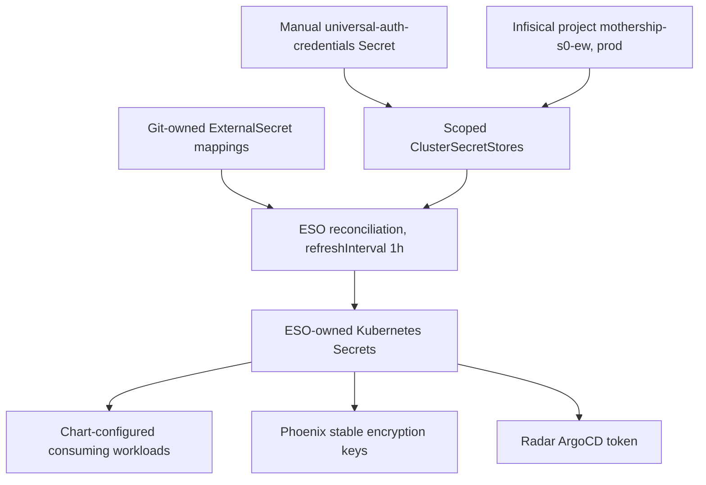

# Infisical and External Secrets ownership

The ownership rule is **Infisical → External Secrets Operator (ESO) → Kubernetes Secret → workload**. Git holds references, key mappings, and chart configuration, never secret values. The only manually created Secret exception is ESO's universal-auth bootstrap credentials; application credentials belong in Infisical, not ad hoc Kubernetes Secrets.

## Bootstrap and scoped access

[ClusterSecretStores](../../apps/external-secrets/clustersecretstore.yaml) all use `https://app.infisical.com`, project `mothership-s0-ew`, environment `prod`. Each store fixes a different `secretsPath`, so an ExternalSecret selects a path by choosing its store and then names keys within that scope. These are provider lookup scopes, not evidence of separate Infisical identities or namespace-level authorization: all six stores reference the same bootstrap Secret.

Before the stores can authenticate, create namespace `external-secrets` and securely provision Secret `universal-auth-credentials` there with keys `clientId` and `clientSecret`. Do not commit its contents or expose them in troubleshooting output. The stores explicitly reference that namespace and those keys.


*Bootstrap authentication and scoped lookups feed ESO-owned Secrets; workloads consume the resulting keys through their chart configuration.*

## Ordering, refresh, and lifecycle

There are two levels of sync waves; wave zero is not the cluster-wide installation order:

- The `external-secrets` parent Application is root wave **2**. Inside it, `external-secrets-helm` is wave **1**, installs CRDs and the controller, and the stores are wave **2**.
- Consumer parents follow: Tailscale **4**, Longhorn **5**, Netdata and Radar **6**, Homarr **7**, Phoenix **9**.
- Within each consumer directory, its ExternalSecret is wave **0** and its Helm Application is wave **1**. This expresses that credentials must precede chart consumers. Still verify ESO readiness and target Secret creation rather than treating a wave annotation as proof that credentials are available.

All six application ExternalSecrets use `external-secrets.io/v1`, `refreshInterval: 1h`, and `creationPolicy: Owner`. Git/ArgoCD owns the ExternalSecret specification; ESO creates and owns the target Secret and refreshes its data from Infisical. Treat deletion or renaming of an owner ExternalSecret as a Secret lifecycle change, not harmless manifest cleanup. Do not hand-edit the generated Secret as the durable fix for a bad upstream value.

A successful refresh proves delivery to Kubernetes, **not application reload**. The manifests do not establish an automatic restart or application-specific reload contract. When rotating credentials, separately verify that the running consumer has adopted them; use a reviewed restart/reload procedure when needed. Encryption keys require a different decision from replaceable API tokens.

## Delivery contracts

The following are key names and references only, not values. Each row's remote keys are relative to its store's path.

| Store and path | Remote key → Kubernetes Secret key | Target Secret and consumer |
|---|---|---|
| `infisical-tailscale`, `/tailscale-operator` | `CLIENT_ID` → `client_id`; `CLIENT_SECRET` → `client_secret` | `tailscale-operator/operator-oauth`; chart `oauth.clientId.existingSecret` and `oauth.clientSecret.existingSecret` |
| `infisical-homarr`, `/homarr` | `HOMARR_DB_KEY` → `db-encryption-key` | `homarr/db-encryption`; Homarr database encryption |
| `infisical-netdata`, `/netdata` | `CLAIMING_TOKEN` → `NETDATA_CLAIM_TOKEN`; `CLAIMING_ROOM` → `NETDATA_CLAIM_ROOMS` | `netdata/netdata-claiming`; both parent and child use `envFrom.secretRef` |
| `infisical-longhorn`, `/longhorn` | `AWS_ACCESS_KEY_ID`, `AWS_SECRET_ACCESS_KEY`, `AWS_ENDPOINTS` → same names | `longhorn-system/longhorn-backup-credentials`; chart `defaultSettings.backupTargetCredentialSecret` |
| `infisical-phoenix`, `/phoenix` | `PHOENIX_SECRET`, `PHOENIX_ADMIN_SECRET` → same names | `phoenix/phoenix-secret`; Phoenix chart auth secret injection |
| `infisical-radar`, `/radar` | `ARGOCD_TOKEN` → `token` | `radar/radar-argocd-token`; chart `argocd.existingSecret` and `argocd.existingSecretKey` |

The Netdata `remoteRef` entries are authoritative: its source comment uses different names, but the actual lookups are `CLAIMING_TOKEN` and `CLAIMING_ROOM`.

### Phoenix: encryption keys are persistent state

[Phoenix's ExternalSecret](../../apps/phoenix/externalsecret.yaml) records a prior failure: chart-generated `PHOENIX_SECRET` used `randAlphaNum` on fresh renders, and rotation during a 5.x → 9.x upgrade made stored PXI provider configuration undecryptable. Persisting the key in Infisical prevents chart rendering from becoming an accidental encryption-key rotation.

[Phoenix chart configuration](../../apps/phoenix/application.yaml) therefore sets `auth.createSecret: false` and injects only `PHOENIX_SECRET` and `PHOENIX_ADMIN_SECRET`. Leaving the chart's default injection list would also demand unused PostgreSQL, SMTP, and initial-admin-password keys, producing `CreateContainerConfigError` when absent. Authentication is explicitly disabled, but the encryption-key requirement remains.

Preserve the original encryption key alongside encrypted database state when planning upgrades or recovery. Do not replace `PHOENIX_SECRET` merely to resolve a sync error: a healthy pod with a new key does not prove old provider configuration is decryptable. See [Storage and backups](../operations/storage-and-backups.md).

### Radar: token delivery is separate from authorization

[Radar](../../apps/radar/application.yaml) reads `radar-argocd-token`, key `token`, and points its ArgoCD integration at `http://argocd-ha-helm-server.argocd.svc.cluster.local`. The [ArgoCD configuration](../../apps/argocd/ha-upgrade.yaml) enables account `radar` with `apiKey` and grants role `radar` only `applications, get, */*`. ESO delivers the token; it does not mint it or define its ArgoCD permissions. Radar's `rbac.secrets: false` is a separate Kubernetes access restriction, not the ArgoCD token's authorization policy.

After rotation, validate an actual Radar-to-ArgoCD read, not just the ExternalSecret status. See [Radar integration](radar.md).

## Two distinct ArgoCD ownership conflicts

### Parent Application: ESO-defaulted ExternalSecret fields

The repository-directory parent Applications in [apps/root.yaml](../../apps/root.yaml) own the ExternalSecret resources. ESO defaults their `remoteRef` fields to `conversionStrategy: Default`, `decodingStrategy: None`, and `metadataPolicy: None`. These live-only fields can leave the parent `OutOfSync` even when its child Helm Application is synced.

Each secret-consuming parent ignores exactly these fields:

```yaml
ignoreDifferences:
  - group: external-secrets.io
    kind: ExternalSecret
    jqPathExpressions:
      - .spec.data[].remoteRef.conversionStrategy
      - .spec.data[].remoteRef.decodingStrategy
      - .spec.data[].remoteRef.metadataPolicy
```

Use `[]` rather than enumerated JSON pointer indexes: new `spec.data` entries must inherit the rule. Include `RespectIgnoreDifferences=true` in the same Application's `syncPolicy.syncOptions`, so the ignore boundary is respected during synchronization as well as comparison. This is not a reason to ignore all ExternalSecret changes; store references and key mappings remain Git-owned.

### Child Helm Application: ESO-managed Secret data

A separate conflict occurs when a chart manages or tracks a Secret whose data ESO refreshes. [Homarr](../../apps/homarr/application.yaml) protects `db-encryption`, and [Tailscale](../../apps/tailscale-operator/application.yaml) protects `operator-oauth`, with Secret-specific JSON pointers:

```yaml
ignoreDifferences:
  - group: ""
    kind: Secret
    name: db-encryption
    jsonPointers:
      - /data
      - /metadata/annotations
      - /metadata/labels
```

Both child Applications also set `RespectIgnoreDifferences=true`. Parent ExternalSecret ignores do not replace these child Secret rules: they apply to different resources at different reconciliation boundaries. Prefer a chart's existing-Secret or disable-secret-creation support; Phoenix's `auth.createSecret: false` explicitly prevents competing chart generation. Do not introduce a broad Secret ignore as a substitute for understanding who creates the object.

## Safe changes and focused checks

For a new consumer, add upstream keys under `/<app-name>`, add its scoped store, add a wave-zero ExternalSecret with explicit target/key mappings, configure the chart to consume it, and add parent default-field ignores plus `RespectIgnoreDifferences=true`. Inspect the chart's actual values schema before choosing configuration keys. Follow [Application changes](../workflows/application-changes.md) and [Reconciliation](../architecture/reconciliation.md).

Use these checks without dumping Secret data:

```bash
kubectl get clustersecretstores
kubectl -n phoenix describe externalsecret phoenix-secret
kubectl -n radar describe externalsecret radar-argocd-token
kubectl -n radar get secret radar-argocd-token
argocd app diff radar
argocd app diff radar-helm
mise run validate:gitops
```

Check store authentication and scope first, then remote key spelling, ExternalSecret readiness/events, target Secret existence, chart references, and finally consumer behavior. For drift, distinguish default-field noise on the parent from Secret ownership contention in the Helm child. For Phoenix startup errors, check requested key names before changing key material.

The [GitOps validation script](../../scripts/validate-gitops.sh) renders exact-pinned Helm Applications and runs strict `kubeconform` validation with missing schemas ignored. It is useful for chart changes, but does not authenticate to Infisical, reconcile ESO, or test application reload/decryption. Runtime checks remain necessary. The symptom-specific guidance is in [Troubleshooting](../../docs/troubleshooting.md#externalsecret-causes-parent-app-outofsync).
