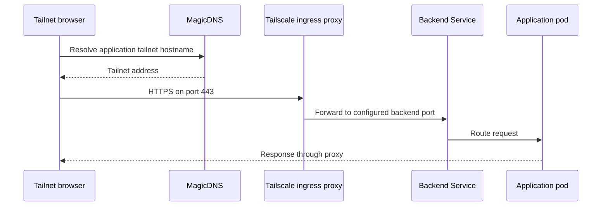
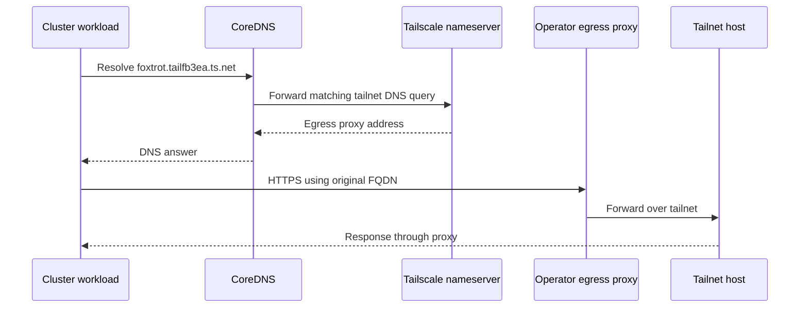

# Tailnet ingress, egress, DNS, and access boundaries

Tailscale has two separate roles here: **ingress** gives tailnet users HTTPS access to cluster applications; **egress** lets cluster workloads reach hosts on the tailnet. DNS connects the egress pieces, while NetworkPolicy closes a different boundary: direct access from other cluster pods.

All web UIs **must use Tailscale Ingress, with no public exposure**. That requirement is not a claim that backend ClusterIPs are inaccessible inside Kubernetes. An application relying on the tailnet as its user-access boundary also needs an explicit internal access policy. These are repository requirements in [AGENTS.md](../../AGENTS.md) and the [networking guide](../../docs/tailscale-networking.md).

This repository owns application-facing manifests. Talos/Omni provisioning, SideroLink, and the Cilium MTU rationale belong to [Omni-Scale](https://github.com/basher83/Omni-Scale), not this page. See also [Workload services](../architecture/workload-services.md) for application structure.

## Operator and reconciliation responsibilities

The [operator Application](../../apps/tailscale-operator/application.yaml) installs the Tailscale Helm chart, currently pinned to `1.104.4`, in `tailscale-operator`. It consumes the `operator-oauth` Secret, sets hostname `talos-prod-operator`, and enables `apiServerProxyConfig.mode: "true"`. Its automated sync uses prune, self-heal, server-side apply, and `RespectIgnoreDifferences=true`.

Proxy pods need privileged networking. The [namespace manifest](../../apps/tailscale-operator/namespace.yaml) therefore sets the Pod Security `enforce`, `audit`, and `warn` labels to `privileged`. A proxy creation error mentioning a baseline PodSecurity violation should lead here before debugging application endpoints.

Git declares Ingress resources, annotated egress Services, and DNS configuration. The operator creates the proxies and nameserver and rewrites egress Service destinations. ArgoCD must preserve those runtime-owned fields rather than continuously trying to restore placeholders.

## Ingress: tailnet HTTPS to a backend Service



The ingress path uses tailnet name resolution and automatic TLS, independently of the CoreDNS forwarding used by cluster workloads below.

The [Homarr Ingress](../../apps/homarr/ingress.yaml) is a compact reference: `ingressClassName: tailscale`, TLS host `homarr`, and `defaultBackend` pointing at `homarr-helm:7575`. Tailscale Ingress serves HTTPS on port 443 even though the backend listens on a different port. Initial access can be slow while the certificate provisions.

Do not replace this with `tailscale.com/expose` on a Service for browser UIs. Service annotation exposure forwards the backend port rather than providing the same HTTPS-on-443 pattern; some charts also fail to propagate Service annotation values. These failure modes are documented in [troubleshooting](../../docs/troubleshooting.md#tailscale-service-exposure-uses-backend-port).

## Tailnet exposure is not ClusterIP isolation

[Radar](radar.md) makes the security distinction concrete: its [Helm values](../../apps/radar/application.yaml) use `auth.mode: none`, enable MCP, and expose a ClusterIP Service on `9280`. Its [Ingress](../../apps/radar/ingress.yaml) routes both UI and MCP traffic to that Service. An ordinary pod calling the backend directly would avoid the tailnet ingress path unless a separate control blocks it.

The [Radar NetworkPolicy](../../apps/radar/networkpolicy.yaml) selects pods with both `app.kubernetes.io/name: radar` and `app.kubernetes.io/instance: radar`. It permits ingress on TCP `9280` from this single combined peer:

```yaml
- namespaceSelector:
    matchLabels:
      kubernetes.io/metadata.name: tailscale-operator
  podSelector:
    matchLabels:
      tailscale.com/managed: "true"
      tailscale.com/parent-resource: radar
      tailscale.com/parent-resource-ns: radar
      tailscale.com/parent-resource-type: ingress
```

The namespace selector and pod selector must remain **in the same `from` item**: they are an AND, not two alternative sources. Splitting them into separate items broadens access. The four proxy labels tie access to Radar's managed ingress proxy, not every pod in the operator namespace.

Do not use the operator-generated `app` UUID as a committed policy identity. Revalidate these stable parent-resource labels on a live proxy after operator upgrades, especially before copying this policy to another application. This policy is ingress-only; it is not an outbound restriction. Also review other policies selecting the same workload before treating the allowance as exclusive, because Kubernetes policy allowances are additive.

## Egress: proxy a tailnet host and preserve its hostname

The egress pattern combines an annotated Service, the Tailscale nameserver, and CoreDNS forwarding. [Homarr's Services](../../apps/homarr/proxmox-egress.yaml) target `foxtrot`, `alpha`, and `lloyd` under `tailfb3ea.ts.net`. [Longhorn's Service](../../apps/longhorn/minio-egress.yaml) targets `truenas-scale.tailfb3ea.ts.net` for the MinIO S3 API used by backups; see [Storage and backups](../operations/storage-and-backups.md).

A declaration starts with an intentionally nonfunctional destination:

```yaml
apiVersion: v1
kind: Service
metadata:
  name: proxmox-foxtrot
  namespace: homarr
  annotations:
    tailscale.com/tailnet-fqdn: foxtrot.tailfb3ea.ts.net
spec:
  type: ExternalName
  externalName: placeholder
```

The operator rewrites `spec.externalName` to its managed destination. The owning **directory Applications** `homarr` and `longhorn` in [apps/root.yaml](../../apps/root.yaml) ignore `/spec/externalName` on Services and enable `RespectIgnoreDifferences=true`. These are not the nested `homarr-helm` or `longhorn-helm` Applications: put the drift exception on the Application that actually reconciles the egress Service.



The workload uses the real tailnet FQDN while DNS directs it through the managed egress path. Keeping `https://foxtrot.tailfb3ea.ts.net` preserves SNI for valid TLS with Tailscale Serve; changing clients to a Kubernetes Service alias is not the documented TLS pattern.

## DNS state and CoreDNS persistence

The [DNSConfig](../../apps/tailscale-operator/dnsconfig.yaml), `ts-dns`, declares a nameserver using `tailscale/k8s-nameserver:unstable`. The checked-in [CoreDNS ConfigMap](../../apps/tailscale-operator/coredns/configmap.yaml) forwards both `ts.net:53` and `tailfb3ea.ts.net:53` to `10.108.67.5`, with `cache 30`. The ordinary root server block retains Kubernetes service discovery and forwarding through `/etc/resolv.conf`.

**The forwarding IP is lifecycle-dependent, not an immutable constant.** If `DNSConfig` is recreated, the nameserver Service's ClusterIP can change. Revalidate it before trusting the checked-in target:

```bash
kubectl get svc nameserver -n tailscale-operator -o jsonpath='{.spec.clusterIP}'
```

If it differs, update both forwarding blocks in Git. Restoring the old ConfigMap faithfully will not repair a stale IP.

Talos lifecycle events can overwrite CoreDNS configuration. The [coredns-tailscale Application](../../apps/tailscale-operator/coredns-patch.yaml) manages the ConfigMap in `kube-system` with server-side apply and **self-heal enabled, prune disabled**. Self-heal restores the declared configuration after overwrite; disabling prune avoids deleting the ConfigMap when the application is removed. Do not enable prune as a routine cleanup change.

## Focused validation and failure isolation

Use these checks when introducing an ingress, adding an egress host, or upgrading the operator. They are operational acceptance checks, not evidence that the live cluster has already passed them.

| Check | Expected boundary or behavior |
| --- | --- |
| Access the UI by its tailnet hostname | HTTPS on 443 reaches the configured backend; allow time for initial TLS provisioning. |
| Inspect operator proxy creation failures | PodSecurity labels permit privileged proxy networking. |
| Inspect an egress Service after reconciliation | `externalName` is operator-populated rather than `placeholder`, without ArgoCD fighting the mutation. |
| Resolve the real target FQDN from a workload pod | CoreDNS forwards tailnet queries to the current nameserver IP. |
| Connect using the real HTTPS FQDN | Connectivity and SNI both work, not just DNS resolution. |
| After DNSConfig recreation | The live nameserver ClusterIP matches both checked-in forwarders. |
| After an operator upgrade | Radar proxy labels still match the combined namespace/pod selector. |
| Test Radar through ingress and from an ordinary cluster pod | The tailnet path succeeds while direct backend access from the ordinary pod is denied. |

The repository's [GitOps validator](../../scripts/validate-gitops.sh) renders exact-pinned Helm Applications and schema-checks their output. It is useful for chart changes, but is not a live test of DNS forwarding, operator-generated labels, TLS, or ClusterIP bypass prevention. Use [Bootstrap and triage](../operations/bootstrap-and-triage.md) and the [source networking guide](../../docs/tailscale-networking.md) alongside these focused checks.
