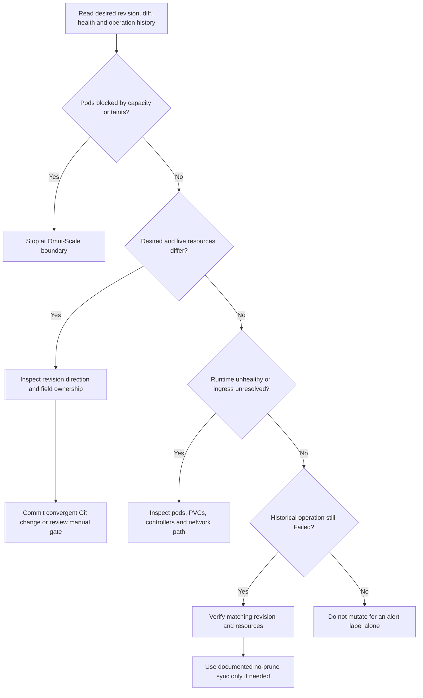

# Bootstrap gates, recovery, and reconciliation triage

## Start at the right authority

Use [README: Bootstrap](../../README.md#bootstrap) for prerequisites and deployment commands and [README: Recovery](../../README.md#recovery) for a full rebuild. Do not treat this page as a second installation script. For orientation, see [Quickstart](../quickstart.md) and [Reconciliation](../architecture/reconciliation.md).

This repository owns what runs **on** the Omni-managed Talos cluster: Applications, secrets wiring, storage configuration, networking exposure, and workloads. [Omni-Scale](https://github.com/basher83/Omni-Scale) owns cluster lifecycle, machine classes, worker capacity, taints, and substrate troubleshooting. If a diagnosis reaches that boundary, stop here and hand it off; do not compensate by weakening workload HA requirements.

## Bootstrap ordering and the HA readiness gate

Bootstrap deliberately precedes normal GitOps reconciliation:

- **Cilium before scheduling:** ArgoCD needs a functioning CNI. The README requires the explicit `MTU=1450` override; do not omit it or substitute an autodetected value. The substrate rationale belongs to Omni-Scale.
- **ESO before secret-store resources:** ESO CRDs must exist before ArgoCD applies `ClusterSecretStore` objects. The manually supplied `universal-auth-credentials` Secret is the documented bootstrap exception; normal secrets flow **Infisical → ESO → Kubernetes Secret**, never committed values.
- **Longhorn before its dependent workloads:** the README installs Longhorn without hooks to break the hook/ServiceAccount ordering problem. Namespace privilege requirements are also part of that procedure.
- **Non-HA ArgoCD before self-management:** Helm installs the initial controller; [the bootstrap manifest](../../bootstrap/bootstrap.yaml) creates the `argocd` namespace and `root` Application pointing at `apps/` on `main`. Applying that manifest alone is not a replacement for installing the prerequisites.

The root orchestrates the platform through waves: secrets at 2, Tailscale and ArgoCD ingress at 4, storage at 5, monitoring and Radar at 6, dashboard at 7, the external OAuth proxy at 8, Phoenix at 9, and the HA gate at 99. ExternalSecrets precede their consumers within application stacks. See [the authoritative wave and exception table](../../docs/architecture.md#sync-waves).

**Wave 99 is not permission to upgrade automatically.** Wait for the bootstrap-managed applications to be healthy and Longhorn to be able to provision PVCs. The [HA values](../../apps/argocd/ha-upgrade.yaml) enable Redis HA persistence on the `longhorn` StorageClass. Promotion then has two separately reviewed stages:

1. `argocd-ha` reconciles the wrapper and creates or updates `argocd-ha-helm`.
2. `argocd-ha-helm` applies the chart and HA values.

Neither Application has automated sync. Review the diff at each stage using the [CLI gate procedure](../../docs/argocd-cli.md#common-commands); syncing the wrapper does **not** sync the nested chart. Check chart upgrade notes and schedulable capacity before the second stage.

## Establish access, then inspect without mutating

There are two independent choices: how Kubernetes is reached, and whether the ArgoCD CLI uses Kubernetes directly or the ArgoCD server.

| Access path | Operational meaning |
|---|---|
| Omni Kubernetes proxy | Primary administration path and authoritative lifecycle plane. |
| Tailscale Kubernetes API server proxy | Standing secondary Kubernetes access path, not a replacement for Omni lifecycle management or application ingress. External tailnet grants must be revalidated before recovery relies on them. |
| ArgoCD **core mode** | Uses kubeconfig and bypasses the ArgoCD API server and its RBAC. Authority comes from the Kubernetes identity, not a read-only ArgoCD session. |
| ArgoCD **server mode** | Uses the ArgoCD API and ArgoCD account/RBAC through Tailscale Ingress. Requires a valid server session and gRPC-web. |

Follow [ArgoCD CLI](../../docs/argocd-cli.md) for setup and [ADR-002](../../docs/adrs/ADR-002-enable-tailscale-api-server-proxy.md) for the secondary API path. Core mode needs the `argocd` namespace: use a dedicated `talos-prod-argocd` kubeconfig context rather than altering the context generated by `tailscale configure kubeconfig`. `configmap "argocd-cm" not found` can be a namespace error, not a missing ArgoCD installation. An Omni call can also be waiting for browser authentication through `kubectl oidc-login`.

Server mode reaches `argocd-ha-helm-server` through `argocd.tailfb3ea.ts.net`; TLS terminates at the Tailscale proxy while the backend runs with `server.insecure: true`. Use `--grpc-web` when establishing a fresh session. An expired-token error calls for reauthentication, not a sync. Keep passwords and tokens out of Git and diagnostic transcripts. Radar's API-key account has only `applications, get`; it is not an operator login or sync identity.

Start with read-only inspection, explicitly choosing the intended context:

```bash
argocd context
argocd version
argocd app list
argocd app get <app>
argocd app diff <app>
```

These application examples assume server mode. For configured core mode, use the documented prefix `--core --kube-context talos-prod-argocd`. Supplement with read-only Kubernetes inspection of Application status/history, pod events, PVCs, and relevant controller logs. Record the context, desired revision, sync status, health status, and operation phase separately.

The CLI is Homebrew-managed, not pinned in `mise.toml`; the server follows the manually promoted chart. **Version skew is therefore expected to be checked, not guessed.** The CLI guide's **2026-11-07** observation was client v3.6.1 versus live server v2.14.11, while Git pinned chart `10.14.0`. Those are dated observations, not a current version inventory. In particular, a queued gate can represent a major upgrade. Core mode is especially sensitive because it reads server-side ConfigMaps and CRDs directly.

## Triage before requesting a sync


*The flow separates substrate blockers, desired/live drift, runtime failures, and stale failed-operation history; these dimensions can coexist, so reassess after each resolved blocker.*

### Desired/live drift: fix the cause in Git

Read both the parent and nested Application. A healthy workload can still be `OutOfSync`, and retrying a sync can make a healthy release worse if Git requests a downgrade. Compare `spec.source.targetRevision`, deployment history, and live chart version first.

The [Longhorn downgrade case](../../docs/troubleshooting.md#longhorn-helm-sync-attempts-a-downgrade) records a **2026-08-16** investigation where a stale `1.12.0` pin followed a running `1.12.1` release. The history established the downgrade trigger, not the hook's lost internal error. Its documented correction is Git-convergent: deliberately select the forward revision, disable the GitOps-incompatible pre-upgrade checker, and preserve no-prune policy on **both** Applications.

Not all differences are missing desired configuration. ESO defaults need parent-level `ignoreDifferences` covering every `.spec.data[]` entry and `RespectIgnoreDifferences=true`. ESO-managed Secrets and Tailscale-rewritten `ExternalName` fields also have documented ownership exceptions. Apply narrowly scoped ownership rules, not blanket ignores that hide real drift; consult [Troubleshooting](../../docs/troubleshooting.md).

### Stale failed operation: distinguish history from health

An Application can be `Synced` and `Healthy` while its last `operationState` remains `Failed`; Radar may continue reporting `gitops_operation_failed`. After verifying the corrected desired revision, live chart, and rendered resources agree, the Longhorn procedure permits one **no-prune sync of the matching revision** to refresh operation history. Verify the new phase is `Succeeded` and the Radar issue clears. If no ArgoCD API session is available, the same procedure documents a one-time Kubernetes operation request. It is not a general license to patch desired state or force a downgrade.

A Radar “spec changed” label is also insufficient evidence for mutation. The **2026-08-16** investigation found Application generation churn associated with a missing CRD status subresource. Check the live CRD, actual `.spec`, and desired/live diff; generation-only records do not justify a sync or rollback. See [Radar](../integrations/radar.md).

### Runtime and network failure: inspect the failing layer

`Progressing` commonly means unresolved ingress health or a Deployment waiting for schedulable pods. Inspect events before changing values. A chart-created ingress that is not used should be disabled in Git in favor of the local Tailscale Ingress pattern.

For UI access, distinguish Tailscale Ingress from Service annotation exposure: Ingress provides automatic TLS on 443, whereas `tailscale.com/expose` forwards the backend port. Proxy creation can fail under baseline PodSecurity; the operator namespace carries the privileged pattern. Initial certificate provisioning can delay first access.

For pod-to-tailnet access, inspect the egress Service, `DNSConfig` nameserver, and CoreDNS `ts.net` forwarding. Talos lifecycle events can overwrite CoreDNS; `coredns-tailscale` self-heals it without pruning. A recreated `DNSConfig` may change the nameserver ClusterIP, so revalidate the target rather than trusting an old value. See [Tailscale networking](../integrations/tailscale-networking.md) and [the repository networking guide](../../docs/tailscale-networking.md).

For capacity alerts, missing CPU/memory samples mean **unknown**, not zero. Radar's scheduling ledger uses allocatable capacity and requests, separately from the Metrics API and PromQL integrations; healthy Netdata does not prove those paths work. Likewise, Longhorn instance-manager PDBs allowing zero voluntary disruptions are documented storage protection, not permission to relax them. Use [Storage and backups](storage-and-backups.md) for maintenance and data-protection context.

### Substrate capacity: stop rather than dilute HA

The documented Redis HA Pending example requires three anti-affine replicas but has only two schedulable workers; three tainted control-plane nodes do not supply worker slots. Hand capacity changes to Omni-Scale. Do not reduce Redis replicas or add tolerations as a manifest workaround. The same boundary applies when resource requests, selectors, taints, or worker availability reveal a machine-class or cluster-template problem.

## Mutation and recovery guardrails

- Default to committed, convergent desired-state changes. Automated sync normally includes prune and self-heal, so an ad hoc live edit is not a durable repair.
- **Never enable or request prune** for `longhorn`, `longhorn-helm`, or `coredns-tailscale`. Storage CRD pruning can delete stored custom resources; CoreDNS must survive Application removal.
- Preserve manual gates for `argocd-ha`, `argocd-ha-helm`, and `anthropic-oauth-proxy`. The last is a cross-repository promotion gate, not an ordinary auto-synced workload.
- The documented SSA `RollingUpdate` → `Recreate` failure permits a break-glass JSON patch removing stale `rollingUpdate` fields, or a reviewed resource replacement. These are exceptions, not routine repair steps. Keep Git convergent with `rollingUpdate: null`; follow [the exact procedure](../../docs/troubleshooting.md#deployment-strategy-change-stuck-serversideapply).
- Before promoting manifest changes, run the repository's focused pre-commit checks and relevant `mise run ci` gate. Helm rendering and kubeconform validation are cluster-independent: they do not prove CRD semantics, admission, reconciliation, or runtime health. See [Validation gates](../testing/validation-gates.md).

For full loss of the cluster, rebuild the substrate through Omni-Scale and then follow the README deployment sequence. Git restores configuration, **not workload data**: the README warns Longhorn data is lost unless backed up to S3. Validate backup coverage and restoration separately from Application sync status. Treat incident reports and dated runtime checks as diagnostic evidence to recheck, never as guarantees of present health.
