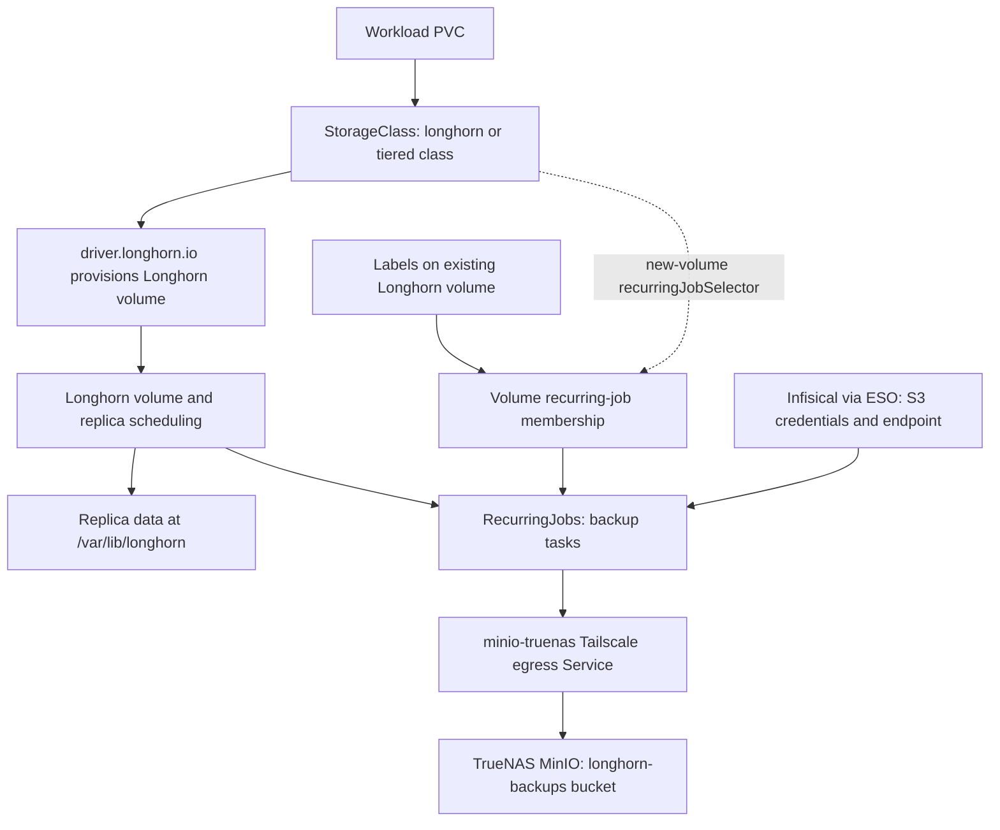

# Longhorn persistence, backup tiers, and restore safety

Longhorn is the persistence substrate; MinIO on TrueNAS is the separate S3 backup destination. Replicas, local snapshots, and off-volume backups solve different problems. A healthy ArgoCD Application or a declared backup schedule is not evidence that a usable recovery point exists.

## Ownership and persistence path

The parent `longhorn` Application in [apps/root.yaml](../../apps/root.yaml) reconciles `apps/longhorn` at wave 5. It owns local configuration and the nested `longhorn-helm` Application. The nested Application installs chart **1.12.1** in `longhorn-system`, with self-healing enabled and the pre-upgrade checker Job disabled.

[Helm settings](../../apps/longhorn/application.yaml) configure two replicas, `/var/lib/longhorn` as the data path, a 10% minimum available storage setting, and default disk creation on labeled nodes. The chart creates the default `longhorn` StorageClass with two replicas. These are desired settings, not proof that two healthy replicas are currently available.


*Persistence and intended backup flow; the tier selector mismatch below must be checked before relying on automatic scheduling.*

The [tiered StorageClasses](../../apps/longhorn/storageclasses.yaml) all use `driver.longhorn.io`, two replicas, `ext4`, `staleReplicaTimeout: "2880"`, immediate binding, and volume expansion. Their `fromBackup` value is empty: ordinary provisioning is not a restore request.

For workload context, see [Workload services](../architecture/workload-services.md).

## Backup tiers: intent versus effective membership

[RecurringJobs](../../apps/longhorn/recurringjobs.yaml) define the following backup tasks, each with `concurrency: 1`:

| Tier / actual job group | Job name | Cron | Retain count | Nominal history at successful cadence |
|---|---|---|---|---|
| `critical` | `backup-critical` | `0 */4 * * *` | 42 | 7 days |
| `important` | `backup-important` | `0 2 * * *` | 14 | 14 days |
| `standard` | `backup-standard` | `0 3 * * 0` | 4 | 4 weeks |

Retention is a **count**, not a guaranteed recovery window. Missed jobs, failed transfers, or an unselected volume invalidate the nominal history. The manifest does not declare a timezone; do not interpret these times as a documented operator-local timezone.

### New volumes

The repository intends `longhorn-critical`, `longhorn-important`, and `longhorn-standard` to attach the corresponding tier when provisioning a PVC:

```yaml
spec:
  storageClassName: longhorn-critical
```

**Important wiring discrepancy:** the committed classes use selectors such as:

```yaml
recurringJobSelector: '[{"name":"backup-critical","isGroup":true}]'
```

But `backup-critical` is the **job name**, while the job's `groups` entry is **`critical`**. The same discrepancy exists for important and standard. Because `isGroup: true` requests a group, the class configuration does not name the declared tier group. The [backup guide](../../docs/backup-storage.md) describes automatic assignment, but the manifests do not establish that it works as intended. Inspect actual volume membership and successful backups, and reconcile the selector/group names in a reviewed change before trusting new-volume automatic coverage.

The default **`longhorn` class has no automatic backup tier**. Merely using Longhorn is not enrollment in recurring backups.

### Existing volumes and rebuild assignments

For an already provisioned volume, apply the recurring-job group label to the **Longhorn Volume**, not the PVC. A StorageClass declaration is a provisioning input, not proof of existing-volume membership.

```bash
# Get volume name from PVC
kubectl get pvc <pvc-name> -n <namespace> -o jsonpath='{.spec.volumeName}'

# Label volume for tier
kubectl label volumes.longhorn.io <volume-name> -n longhorn-system \
  recurring-job-group.longhorn.io/<tier>=enabled
```

The [rebuild mapping](../../docs/backup-storage.md) calls for:

| Namespace | PVC | Tier to reapply |
|---|---|---|
| `homarr` | `homarr-database` | `critical` |
| `argocd` | `data-argocd-ha-helm-redis-ha-server-0`, `-1`, `-2` | `important` |
| `netdata` | `netdata-parent-database`, `netdata-parent-alarms`, `netdata-k8s-state-varlib` | `standard` |

This is an operational assignment list, not evidence of current labels. Re-resolve PVC volume names after a rebuild; do not assume old volume identities or labels survived. Phoenix's `phoenix/phoenix-helm-data-pvc` is documented as having no backup tier. Radar requests `longhorn-standard`, so its intended coverage also depends on resolving the selector discrepancy.

## MinIO credentials, connectivity, and permissions

The configured target is `s3://longhorn-backups@us-east-1/`, using Secret `longhorn-backup-credentials`. The [ExternalSecret](../../apps/longhorn/externalsecret.yaml) refreshes hourly through `ClusterSecretStore/infisical-longhorn`, which reads the `prod` `/longhorn` scope in Infisical. It creates an owner-managed Secret containing:

- `AWS_ACCESS_KEY_ID`
- `AWS_SECRET_ACCESS_KEY`
- `AWS_ENDPOINTS` — the endpoint value must include protocol and port.

The [egress Service](../../apps/longhorn/minio-egress.yaml) is `minio-truenas` in `longhorn-system`, an `ExternalName` Service annotated with `tailscale.com/tailnet-fqdn: truenas-scale.tailfb3ea.ts.net`. Its committed `externalName: placeholder` is not the final routing target. The parent ignores `/spec/externalName` differences so operator-managed routing is not overwritten. The backup guide identifies the MinIO API on port `9000`; the actual secret endpoint value is not committed here.

The [MinIO policy](../../minio-config/longhorn-backups-policy.json) allows bucket listing on `longhorn-backups` and object get, put, delete, and multipart operations within that bucket. It additionally permits global `s3:ListAllMyBuckets` for compatibility. This is not an immutable backup policy: object deletion is explicitly allowed. The policy file alone does not prove it is installed or that credentials are valid.

See [Secrets](../integrations/secrets.md) and [Tailscale networking](../integrations/tailscale-networking.md) for integration ownership.

## Deletion protection is not data retention

Preserve **`prune: false` on both `longhorn` and `longhorn-helm`**. The parent protects storage-related resources from automated pruning; the nested Application protects chart-owned CRDs and controllers. If a chart stops rendering a CRD, pruning it would delete the custom resources stored under it and destroy storage control-plane state.

This safeguard is narrow:

- All three repository-defined tiered StorageClasses explicitly use **`reclaimPolicy: Delete`**. Releasing their PV through PVC deletion can delete the underlying volume; no-prune does not turn them into `Retain` volumes. Inspect the actual PV policy before deleting a claim. The default chart-generated class is not defined in `storageclasses.yaml`; inspect its rendered/live policy rather than assuming protection.
- No-prune does not block direct Kubernetes or Longhorn deletion, schema migrations, or destructive updates to resources that remain desired.
- The parent Application carries `resources-finalizer.argocd.argoproj.io`. Do not treat disabling automated prune as disabling Application-deletion cascades.
- Replication does not replace off-volume backups, and a local snapshot should not be treated as an independent MinIO copy.

## Safe upgrades and restore-based rollback

### Storage chart convergence

Keep `preUpgradeChecker.jobEnabled: false`; the [troubleshooting guide](../../docs/troubleshooting.md) records the chart's instruction to disable this hook for GitOps installations. Disabling the hook is not permission to force a downgrade.

Before retrying a failed `longhorn-pre-upgrade` operation, compare desired revision with deployment history and the live chart version:

```bash
kubectl -n argocd get application longhorn-helm \
  -o jsonpath='{.spec.source.targetRevision}{"\n"}{range .status.history[*]}{.deployedAt}{"\t"}{.revision}{"\n"}{end}'
```

An exact pin below an already deployed version requests a downgrade. The documented incident had `1.12.1` running before a stale `1.12.0` pin reconciled; the history established the downgrade trigger, but the hook's internal error was no longer retained. Correct Git to the deliberately selected convergent version, preserve both no-prune policies, and let ArgoCD reconcile.

A historical `operationState: Failed` can remain even after resources are `Synced` and `Healthy`. Only after verifying desired, live, and rendered versions agree, request a no-prune sync of that matching revision:

```bash
argocd app sync longhorn-helm \
  --app-namespace argocd \
  --revision <matching-revision>
```

### Application schema migrations

Before an upgrade that changes on-disk schema, take a manual Longhorn snapshot and verify readiness. **Reverting a chart version does not revert the database schema.** The documented rollback model is to revert the version bump **and restore the volume from the pre-migration snapshot**, not simply restart the older binary against migrated data.

```bash
VOL=$(kubectl -n <ns> get pvc <pvc> -o jsonpath='{.spec.volumeName}')
cat <<EOF | kubectl apply -f -
apiVersion: longhorn.io/v1beta2
kind: Snapshot
metadata:
  name: <app>-pre-<version>-<yyyymmdd>
  namespace: longhorn-system
spec:
  volume: ${VOL}
  createSnapshot: true
EOF
kubectl -n longhorn-system get snapshots.longhorn.io <name> \
  -o jsonpath='{.status.readyToUse}'
```

The backup guide describes running-pod snapshots as crash-consistent and acceptable for its SQLite example; this is not a general application-consistency guarantee. For other applications, establish the required quiescing or database backup procedure before changing schema. These manual Snapshot objects are outside ArgoCD management. Record them and remove them only after the upgraded application has run cleanly under normal load:

```bash
kubectl -n longhorn-system delete snapshots.longhorn.io <name>
```

The repository documents the snapshot primitive and restore-based rollback requirement, not a complete tested MinIO disaster-recovery procedure. Confirm recovery-point visibility, restore compatibility, and application correctness before declaring recovery complete.

## Maintenance and validation gates

Longhorn instance-manager PDBs selecting one healthy pod with zero allowed voluntary disruptions are **expected storage protection**, not an active workload failure. Do not relax them to silence Radar. Before a node drain, verify volume and replica health and follow Longhorn's controlled maintenance procedure; a blocked eviction is a gate to investigate.

For a storage or backup change, use these focused checks:

1. Run the repository's `mise run ci` gate. [validate-gitops.sh](../../scripts/validate-gitops.sh) renders exact-pinned Helm charts with committed values and validates rendered built-in schemas; missing CRD schemas are ignored. This does not test recurring-job selection, S3 connectivity, admission, or restore behavior.
2. Inspect actual PVC-to-PV-to-Longhorn-volume identities, replica health, and recurring-job membership. In particular, test a newly provisioned tiered PVC after fixing the selector wiring.
3. Verify ExternalSecret readiness, endpoint configuration, Tailscale egress, and successful backup records at the destination. Do not infer success from the cron declaration.
4. After rebuild, reapply the documented existing-volume tier labels and verify new backups. A reconstructed GitOps control plane does not by itself restore workload data.
5. Validate a restore and application read/write behavior in a safe target before relying on a recovery plan. No restore-test result or guaranteed RPO/RTO is established by these manifests.

For broader triage and promotion workflow, see [Bootstrap and triage](bootstrap-and-triage.md) and [Application changes](../workflows/application-changes.md).
