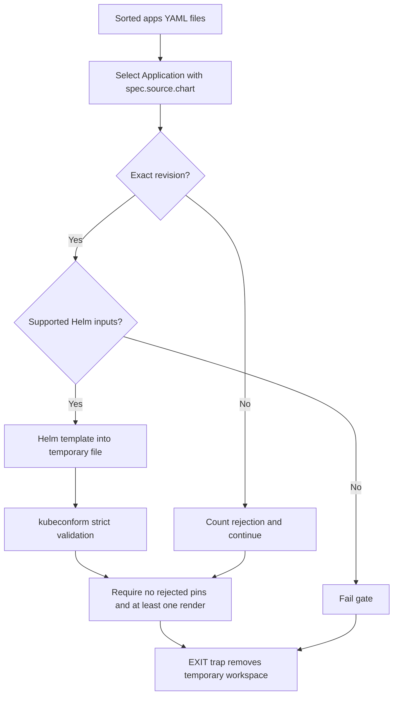

# Local validation, Fast Gate, and runtime verification gaps

A green **Fast Gate** means repository hygiene and the supported Helm render/schema checks passed. It is not a deployment, a unit-test suite, or proof that the deployed system enforces its access boundaries. Treat validation as three distinct layers:

| Layer | What exists | What it establishes |
|---|---|---|
| Executable repository checks | Pre-commit hooks and `scripts/validate-gitops.sh`, composed by Mise and CI | File hygiene, selected configuration schemas, exact chart revisions, and schema validation of rendered resources where schemas exist |
| Focused acceptance contracts | Render inspection, server-side checks, and live tests in deployment specifications | Application-specific security, integration, and persistence behavior, when actually executed and recorded |
| Proposed deterministic assertions | OAuth proxy boundary remediation design | Future checks, not current gate coverage or deployed controls |

## Local entrypoints and installed tools

[`mise.toml`](../../mise.toml) requires Mise `2026.8.12` or newer and installs Helm `4.3.1`, kubeconform `0.8.0`, pre-commit `4.7.0`, ripgrep `15.2.0`, and yq `4.54.2`. From the repository, use:

```sh
mise install
mise run hygiene
mise run validate:renovate
mise run validate:gitops
mise run ci
```

- `hygiene` runs `pre-commit run --all-files --show-diff-on-failure`.
- `validate:renovate` runs only the `check-renovate` hook across all files; it is useful for configuration edits, not a replacement for the full gate.
- `validate:gitops` runs `bash scripts/validate-gitops.sh`.
- `ci` depends on `hygiene` and `validate:gitops`, then prints `Fast gate passed`. Mise allows two jobs; do not interpret these dependencies as a mandatory serial hygiene-then-render sequence.

The [pre-commit configuration](../../.pre-commit-config.yaml) checks trailing whitespace, end-of-file newlines, merge-conflict markers, added files over 1024 KB, YAML parsing with multiple documents allowed, and private-key detection. It also runs relaxed yamllint and schema checks for Renovate and GitHub workflows. These are concrete hygiene and configuration checks, not application behavior tests.

## CI and Renovate's status dependency

The [Fast Gate workflow](../../.github/workflows/fast-gate.yml) runs on pull requests and pushes to `main` and `renovate/**`. It has read-only repository contents permission, uses `ubuntu-latest`, and has a ten-minute timeout. It checks out the repository, installs the Mise tools through `jdx/mise-action` with Mise `2026.11.6` and caching, then runs `mise run ci`. A newer run cancels an in-progress run with the same workflow/ref concurrency group.

The Renovate branch-push trigger is intentional: the inherited `prCreation: not-pending` policy needs a repository-owned result **before** Renovate creates a PR. Renovate automerge depends on this repository's status checks; validating `renovate.json` alone does not validate a proposed chart deployment. The [architecture explanation](../../docs/architecture.md) records this relationship; the external inherited presets are not reproduced in this repository.

[`renovate.json`](../../renovate.json) discovers ArgoCD dependencies under `apps/` using a `.ya?ml` pattern and applies `rangeStrategy: pin`. Chart patches generally allow automerge, but Radar explicitly disables it at every level, as do `longhorn`, `external-secrets`, and `argo-cd`. This distinction matters: a passing render does not replace the rendered RBAC, MCP-surface, and storage review required for a Radar upgrade.

## How Helm validation works

The implementation is [`scripts/validate-gitops.sh`](../../scripts/validate-gitops.sh), not an ArgoCD sync or a cluster query.



*The script rejects unsupported inputs and floating chart revisions, renders supported chart Applications, and cleans up its isolated workspace on exit.*

### Discovery and revision invariants

The script enters the Git repository root and sorts files from `rg --files apps -g '*.yaml'`. It fails if there are no such files. yq reads all YAML documents and selects only `kind: Application` with a non-null `spec.source.chart`, preserving the source filename for diagnostics.

This is specifically **single-source chart Application discovery**. It does not traverse external Git repositories, build Kustomize sources, or discover charts in `spec.sources`. Unlike Renovate's file pattern, the script's discovery includes `.yaml`, not `.yml`.

Each selected `targetRevision` must match:

```text
^v?[0-9]+\.[0-9]+\.[0-9]+([+-][0-9A-Za-z.-]+)?$
```

Floating ranges and wildcards are counted and skipped, with a filename/Application/chart/revision diagnostic. Other pinned charts can still be checked, but any rejected revision causes final failure. The script also fails if no exact-pinned chart Application was rendered. Pinning prevents a range from resolving to a different chart between PR validation and deployment; when converting a live range, use the live version to avoid an accidental downgrade.

### Render inputs and precedence

For each accepted chart:

1. Use `spec.source.helm.releaseName`, falling back to `metadata.name`.
2. Read the chart repository, chart name, revision, and destination namespace from the Application.
3. Reject nonempty Helm `valueFiles` or `parameters` immediately. These are unsupported, not silently ignored.
4. Write `valuesObject` to a temporary YAML file, defaulting to `{}`. If inline `helm.values` is nonempty, write it separately and append it as a second `--values` argument. **Inline values therefore override conflicting `valuesObject` entries in this script**; this is the script's merge order, not a claim of full ArgoCD input parity.
5. Run `helm template` with the release name, version with a leading `v` removed, destination namespace, `--kube-version`, `--include-crds`, and `--skip-tests`.
6. For `http://` or `https://` repositories, use `--repo URL chart`. Otherwise construct `oci://<repository>/<chart>`, stripping any existing `oci://` prefix first.

Release naming is operationally significant. [Radar's child Application](../../apps/radar/application.yaml) is named `radar-helm` but sets `releaseName: radar`; the Service, PVC, and workload instance labels must remain compatible with the local Ingress and NetworkPolicy contract.

### Schema checking and workspace lifecycle

`KUBERNETES_VERSION` defaults to `1.36.0` and controls both Helm's Kubernetes capability version and kubeconform's schema version. The script uses `set -euo pipefail`; ordinary render or validation failures abort the run.

Each rendered file is passed to:

```sh
kubeconform \
  -cache "${validation_tmp_dir}/schema-cache" \
  -ignore-missing-schemas \
  -kubernetes-version "${kubernetes_version}" \
  -strict \
  -summary \
  "${rendered_file}"
```

**Missing schemas are ignored.** Including CRDs in rendered output does not prove custom-resource semantics or controller behavior. Helm tests are explicitly skipped; the script does not run `helm test`.

A fresh `mktemp` workspace holds rendered manifests, extracted values, the schema cache, and isolated `HELM_CACHE_HOME`, `HELM_CONFIG_HOME`, and `HELM_DATA_HOME`. An `EXIT` trap removes the entire workspace, including on ordinary failures. Do not expect rendered files or chart caches to remain available afterward.

## What a passing gate does not prove

The gate does **not** prove CRD semantics, live admission behavior, Argo reconciliation, external Kustomize validity, or runtime health. It also does not prove that a syntactically valid RBAC rule is safe, a NetworkPolicy selects the real ingress proxy, or SQLite history survives a replacement pod. Local YAML parsing is not a server-side dry-run; chart rendering is not application installation.

Keep promotion evidence separate from CI status. For reconciliation and manual-sync boundaries, see [Reconciliation](../architecture/reconciliation.md), [Application changes](../workflows/application-changes.md), and [Bootstrap and triage](../operations/bootstrap-and-triage.md).

## Radar: focused checks beyond the gate

The [Radar deployment specification](../../specs/radar-in-cluster.md) supplies acceptance criteria and dated runtime evidence, not an executable unit-test suite. Use it with the [Radar integration guide](../integrations/radar.md).

### Before publication: inspect the render

Review the actual generated resources, not only schema success:

- One Deployment, a ClusterIP Service on `9280`, one PVC, chart-managed RBAC, and no chart Ingress or HTTPRoute.
- One replica, `Recreate`, SQLite arguments, `/data` storage, and the restricted container security context.
- ClusterRole rules with pod-log reads but no Secret reads, wildcard writes, exec, port-forward, or node mutation authority.
- NetworkPolicy selectors matching rendered workload labels and observed stable Tailscale proxy labels. Namespace and pod selectors must be in the **same** peer item so they are ANDed.
- ArgoCD's `accounts.radar: apiKey` and Application `get` policy, plus Radar's `secretKeyRef` to `radar-argocd-token/token`, pinned internal HTTP endpoint, and `insecureTls: false`. Never resolve or print the token during validation.

The specification separately requests client-side validation of local resources, server-side dry-run of Applications in the existing `argocd` namespace, changed-file pre-commit checks, and `git diff --check`. It explicitly says not to create the future `radar` namespace imperatively just to dry-run its resources.

### After reconciliation: prove both allowed and denied paths

- **Positive access:** an authorized tailnet client loads `https://radar.tailfb3ea.ts.net/`; MCP initializes, lists tools, and completes a read-only call such as `get_dashboard`.
- **Negative access:** an ordinary nonmatching pod cannot connect to `radar.radar.svc:9280`, while the Tailscale ingress proxy can. UI success alone does not rule out a ClusterIP bypass.
- **Kubernetes authority:** test the actual Radar ServiceAccount. Pod-log reads must work; Secrets, Deployment create/patch, exec, and port-forward must fail. The dated evidence warns that `kubectl auth can-i --as=...` through the Tailscale API proxy reflected the caller's broader authority. It instead used a short-lived Radar token directly against a port-forwarded API server.
- **Separate Argo authority:** verify the dedicated ArgoCD token can get Applications but cannot sync, update, delete, invoke actions, or override. Kubernetes ServiceAccount restrictions do not establish this token's scope. Confirm ESO readiness, Secret key metadata without the value, integration connectivity, and an `argocd-api` canonical diff rather than annotation-only fallback.
- **Persistence:** verify PVC binding and SQLite diagnostics, then show that pre-replacement timeline events remain after a normal rollout. A Bound PVC alone is insufficient. Do not force an imperative restart solely for this test.

The specification records successful access, deny, RBAC, deep-diff, and cross-restart retention evidence on **2026-08-16**. That is historical evidence, not a permanent guarantee for later chart or policy changes. Missing metrics, cost, and traffic backends are documented degradations, not grounds to expand permissions silently.

## Proposed checks are not implemented controls

The [OAuth proxy boundary remediation specification](../../specs/oauth-proxy-boundary-remediation.md) is explicitly **planned**. It proposes deterministic assertions rejecting a rendered admin Service and overly broad main-proxy ingress policy. Those assertions are not part of the current Fast Gate.

Source-owned manifests and render tests belong to `tailnet-microservices`; this repository owns the manual ArgoCD promotion gate and deployed boundary evidence. Completion requires positive tailnet main-proxy access, negative ordinary-pod access to both sensitive surfaces, no admin Service or Tailscale admin route, authorized API/RBAC port-forward access, and healthy probes. Live ingress identity, Cilium enforcement, and loopback port-forward compatibility must be verified rather than assumed. Findings remain open until the security owner revalidates the deployed state: neither green CI nor green Argo health closes them.
