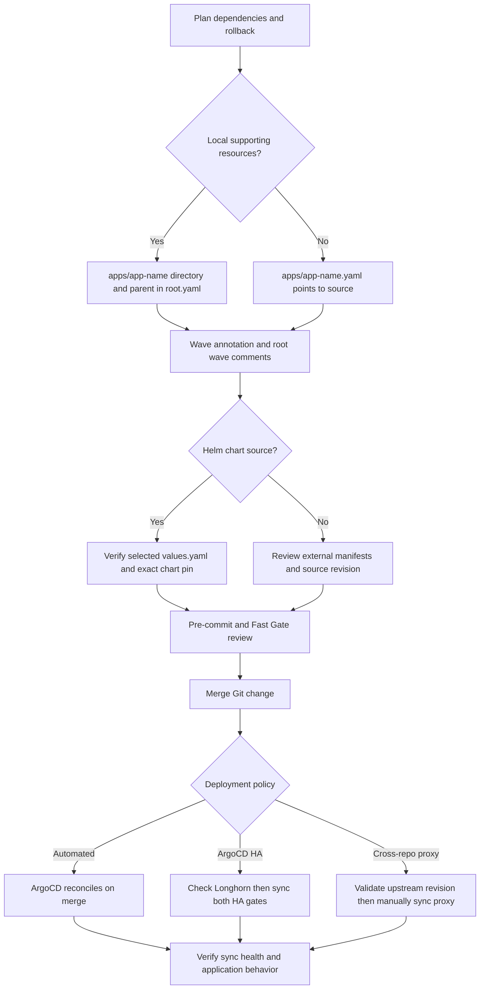

# Add, upgrade, and promote applications safely

A change is not safe merely because its YAML parses. Choose the correct ownership boundary, render the selected chart with the committed values, preserve reconciliation exceptions, and know whether **merge is deployment** or only preparation for manual promotion.

The authoritative implementation checklist is [Adding Applications](../../docs/adding-applications.md). [AGENTS.md](../../AGENTS.md) governs change discipline and wins if a supporting doc conflicts with it. This repository owns ArgoCD-managed workloads and integrations; cluster templates, machine classes, and node-capacity changes belong to `../Omni-Scale`. Do not compensate for substrate limits with manifest hacks. Bootstrap and recovery commands remain in [README.md](../../README.md), not here.

## Change path


The workflow separates application discovery, chart validation, and the deliberate deployment gates; the proxy's upstream merge can also change its desired state without a change in this repository.

## 1. Choose layout and order dependencies

**Use a directory when this repo owns supporting resources.** Create `apps/<app-name>/application.yaml` for the Helm Application and values, plus any local Ingress, ExternalSecret, or extra manifests. Add the parent Application to [apps/root.yaml](../../apps/root.yaml), pointing at the directory. Give it an `argocd.argoproj.io/sync-wave` annotation and update the wave comment header in that file.

**Use a standalone Application when there are no local supporting resources.** Create `apps/<app-name>.yaml`. The root Application discovers YAML directly under `apps/`, so no extra Application entry in `root.yaml` is needed. The standalone Application still needs its wave annotation and a wave-comment update. [anthropic-oauth-proxy.yaml](../../apps/anthropic-oauth-proxy.yaml) is the representative external-source case: it pulls `tailnet-microservices` `main`, path `k8s`, through Kustomize rather than maintaining local resource copies.

Order by dependencies, not just by the next unused number. The current outer waves are ESO **2**, Tailscale and ArgoCD ingress **4**, Longhorn **5**, Netdata and Radar **6**, Homarr **7**, proxy **8**, Phoenix **9**, and manually promoted ArgoCD HA **99**. Nested waves also matter: ESO installs its controller and CRDs before stores, and Tailscale orders DNSConfig, operator, and CoreDNS changes. See [reconciliation](../architecture/reconciliation.md) and the authoritative [architecture policy](../../docs/architecture.md).

### Required integration checklist

- **Web UI:** include a Tailscale Ingress, using `ingressClassName: tailscale`. No public UI exposure and no cluster-internal-only UI. If the chart creates an Ingress, disable that chart Ingress and supply the local Tailscale manifest. Verify the disabling key against the selected chart rather than assuming every chart uses the same key. See [Tailscale networking](../integrations/tailscale-networking.md).
- **Secrets:** use Infisical → ESO → Kubernetes Secret; never commit secret values. For a new application path, add secrets under `/<app-name>` in project `mothership-s0-ew`, prod environment, add a ClusterSecretStore in `apps/external-secrets/clustersecretstore.yaml`, and create the local `externalsecret.yaml`. Give the ExternalSecret sync wave `"0"` so it precedes consumers within the application's wave. The only manual secret is the ESO bootstrap credential. See [secrets integration](../integrations/secrets.md).
- **ESO drift:** add the following to the parent Application in `root.yaml`, together with `RespectIgnoreDifferences=true` in `syncOptions`. ESO defaults otherwise cause permanent `OutOfSync`. Wildcard expressions cover future entries; indexed pointers silently miss later keys.

```yaml
ignoreDifferences:
  - group: external-secrets.io
    kind: ExternalSecret
    jqPathExpressions:
      - .spec.data[].remoteRef.conversionStrategy
      - .spec.data[].remoteRef.decodingStrategy
      - .spec.data[].remoteRef.metadataPolicy
```

- **Persistent data:** use Longhorn `ReadWriteOnce` PVCs. Select `longhorn-critical`, `longhorn-important`, or `longhorn-standard` when data needs scheduled backup; the default `longhorn` class has **no automatic backups**. Existing volumes require tier labels on the Longhorn volume, not merely on the PVC. See [storage and backups](../operations/storage-and-backups.md).

## 2. Select an exact chart and inspect its values

For every Helm chart Application, set `spec.source.targetRevision` to an exact version such as `1.2.3`, not `1.*` or another range. This is a **chart version**, not an assumption about the container image version. Read the actual `values.yaml` for that selected chart release before setting keys, then inspect the rendered resources. Known value-key traps belong in [troubleshooting](../../docs/troubleshooting.md).

When converting an existing range, first compare the desired revision, Application deployment history, and live chart version. Pin to the live version to make range removal behavior-neutral; choose a different version only as an explicit upgrade plan. A stale lower pin can request a downgrade: the documented Longhorn incident involved a live `1.12.1` release later being reconciled toward `1.12.0`. Follow the [Longhorn downgrade diagnosis](../../docs/troubleshooting.md#longhorn-helm-sync-attempts-a-downgrade), not a forced downgrade.

Ranges are unsafe because rendering can resolve a different chart from the one ArgoCD later deploys, and ArgoCD can upgrade without a version-bump PR. `mise run validate:gitops` rejects floating chart revisions. Renovate's `rangeStrategy: pin` is a repair backstop, not permission to introduce ranges.

## 3. Understand Renovate before approving an upgrade

[renovate.json](../../renovate.json) extends shared base and Kubernetes presets, then applies local rules for the `argocd` manager over `apps/` YAML. Read these rules cumulatively: **later matching rules override conflicting earlier settings**. In particular, the broad patch-automerge rule does not override the later review-only exceptions.

| Charts | Patch | Minor | Major |
|---|---|---|---|
| `homarr`, `netdata`, `tailscale-operator` | Automerge after 3-day release age | Separate automerge group, 3-day release age | Dependency Dashboard approval |
| `phoenix` | Automerge | Monday review group | Dependency Dashboard approval |
| `radar` | Review | Monday review group | Dependency Dashboard approval |
| `longhorn`, `external-secrets`, `argo-cd` | Review | Monday review group | Dependency Dashboard approval |

The general minor group is `ArgoCD Charts (Minor)`, scheduled `before 5am on Monday`. The three formerly floating charts override the group name with `ArgoCD Charts (Minor, automerge)` and enable automerge; they retain the matching minor schedule. Their 3-day release-age rule applies beyond just patches. Separating the groups matters because a grouped PR only automerges when every update in it is automergeable; reviewed minors must not block the automerge subset.

Radar disables automerge at every level because upgrades couple its UI, MCP surface, ClusterRole, and SQLite behavior. The final storage/secrets/ArgoCD rule also disables automerge at every level. Storage and secrets are transitive dependencies, while ArgoCD must not silently advance Git ahead of its manual deployment gate. Major-update dashboard approval is not deployment approval and does not itself sync an Application. Shared presets can contribute other defaults; the local file is not a complete copy of inherited policy.

## 4. Validate, document, and merge

Before committing, run the required changed-file checks:

```bash
pre-commit run --files <changed>
```

For chart or manifest changes, use the repository gate as well:

```bash
mise run validate:gitops
mise run ci
```

`validate:gitops` renders each exact-pinned, chart-backed Application found under `apps/` using its release name, namespace, committed `valuesObject`, and inline `values`. It rejects Helm `valueFiles` and `parameters`, which the renderer does not support. It runs strict kubeconform validation, but ignores missing schemas. **This is not proof of custom-resource semantics, admission behavior, ArgoCD reconciliation, or live health. It also does not render the proxy's external Kustomize source.** Validate that source deliberately before promotion.

`mise run ci` combines the render gate with pre-commit hygiene, YAML checks, and Renovate/GitHub Actions schema checks. The repository-owned `Fast Gate` runs on pull requests and pushes to `main` and `renovate/**`. Renovate branch pushes provide a check before PR creation under the inherited `prCreation: not-pending` policy. See [validation gates](../testing/validation-gates.md) for the testing boundary.

Keep one concern per commit and use an app-scoped conventional commit. Describe the actual parent or child Application changed, not a broader safety property the diff does not implement. If the change introduces a caveat, value-key trap, or new sync-policy exception, update the matching authoritative doc **in the same commit**: architecture for policy, adding-applications for patterns, troubleshooting for failures, or backup-storage for persistence. Do not hide durable operational knowledge only in a commit message or duplicate bootstrap commands.

## 5. Promote deliberately and prepare rollback first

For normal automated Applications, merge is the promotion step: ArgoCD reconciles the change with prune and self-heal, normally using server-side apply. Do not merge first and plan the data rollback later.

Preserve these exceptions at the correct layer:

- **ArgoCD HA:** neither `argocd-ha` nor nested `argocd-ha-helm` has automated sync. Merging an `argo-cd` bump only changes Git. Verify Longhorn is healthy and can provision PVCs, then manually sync the parent and nested chart gate. Syncing only the parent is not a substitute for promoting the nested chart.
- **Cross-repository proxy:** `anthropic-oauth-proxy` tracks another repo's `main`, but has no automated sync. An upstream merge changes desired source, not the live deployment. Its documented upstream CI does not gate manifest validity, so inspect the intended source and rendered manifests before manually syncing. Preserve that promotion gate rather than enabling auto-sync for convenience.
- **Deletion-sensitive resources:** keep `prune: false` on both `longhorn` and `longhorn-helm`, and on `coredns-tailscale`. Parent and child flags are not interchangeable: pruning chart-owned storage CRDs could delete their stored custom resources. CoreDNS retains self-heal so lifecycle overwrites of tailnet forwarding can be repaired.

For any upgrade that migrates an on-disk schema, take a manual Longhorn snapshot **before deployment**, verify `readyToUse`, and record the rollback point. Reverting a chart does not reverse a database migration: rollback requires reverting the bump **and restoring the volume**. This is especially important for un-tiered volumes such as Phoenix's SQLite PVC, where the snapshot may be the only copy. Follow [pre-upgrade snapshot operations](../../docs/backup-storage.md#pre-upgrade-snapshots); record outstanding snapshots there and remove them after stable operation rather than leaving unmanaged copies indefinitely.

After promotion, verify ArgoCD sync and health, the selected live revision, storage behavior, and the actual UI or API path through its intended access boundary. Keep remediation Git-convergent; reserve imperative changes for documented break-glass procedures. Static gate success is a prerequisite, not a runtime acceptance test.
